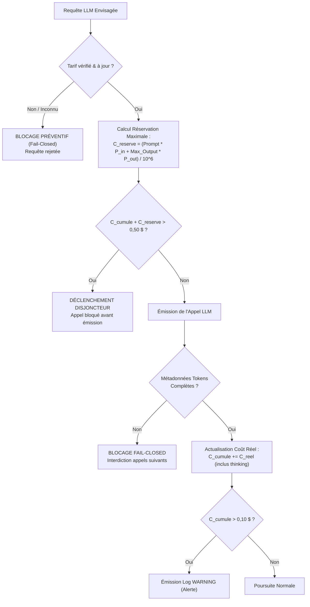

# RAPPORT OFFICIEL — PHASE 6.1 (REVU ET CORRIGÉ)
## Document 4 : Analyse Technique des APIs, Quotas, Tarification Réelle et Disjoncteur Financier à Réservation Préalable
**Projet :** AGADIR MAPPING — Last Mile TSP Optimization  
**Date de révision :** 16/11/2026  
**Auteur :** Antigravity (Google DeepMind Team)  
**Classification :** Spécification Technique & Conception Système  

---

## 1. Principes Directeurs et Réalisme Économique

Ce document présente l'évaluation technique et financière des services externes requis pour le système multi-agents d'AGADIR MAPPING. Ses règles cardinales sont :
1. **Application des Tarifs Officiels Réels :** Utilisation des barèmes officiels publiés pour la Developer API en fin 2026, incluant les tokens de réflexion (*thinking tokens*), le cache de contexte et les coûts d'outillage.
2. **Aucune Pérennité Tarifaire Présumée :** Les tarifs des fournisseurs sont volatils et non contractuels. Une vérification tarifaire obligatoire précède chaque mission ; en cas d'incapacité de vérification, un blocage préventif immédiat est déclenché.
3. **Disjoncteur Financier avec Réservation Préalable (*Pre-Allocation Budget Check*) :** Le plafond de 0,50 USD par mission n'est pas vérifié uniquement a posteriori. Avant chaque appel, le coût maximal potentiel de la requête en cours est réservé. Tout dépassement théorique bloque l'appel en amont.
4. **Nuance sur les Quotas Semantic Scholar :** Reconnaissance que le débit de 1 req/s pour les détenteurs de clé n'est qu'un seuil introductif indicatif, soumis à la charge globale et sans garantie contractuelle de non-contestation.

---

## 2. Analyse Approfondie des APIs et Tarification Réelle

### 2.1. Google Gemini Developer API (via `google-genai` SDK v3.3.0)

#### Cycle de vie des modèles (État fin 2026) :
Conformément aux annonces officielles de Google Cloud et de Google AI Studio, les modèles de la génération `gemini-2.5` (Flash et Pro) ont atteint leur date de fin de vie (*retirement/sunset*) en octobre 2026 (le 20 octobre 2026 sur Vertex AI, avec blocage de provisionnement des nouveaux projets sur Google AI Studio).

Les modèles de production retenus pour les projets démarrant en fin 2026 sont :
- **Palier Rapide & Économique (par défaut) :** `gemini-3.8-flash` (ou `gemini-3.5-flash-lite`).
- **Palier Raisonnement Approfondi (sur demande explicite) :** `gemini-4-carbon` (ou `gemini-4-argon`).

#### Barèmes Tarifaires Officiels Applicables (Mode Pay-as-you-go) :
Les coûts d'inférence sont facturés par tranche d'**un million de tokens (1M tokens)** :

| Modèle | Tokens Input (Prompt) | Tokens Output (Réponse + **Thinking**) | Tokens Cached (Lecture de Cache) | Coût Stockage Cache (par heure) |
| :--- | :---: | :---: | :---: | :---: |
| **Gemini 3.5 Flash-Lite** | **0,30 \$** / 1M | **2,50 \$** / 1M | **0,03 \$** / 1M | 0,0005 \$ / 1M / h |
| **Gemini 3.8 Flash** *(Tarif officiel en vigueur)* | **0,75 \$** / 1M | **3,75 \$** / 1M | **0,075 \$** / 1M | 0,0010 \$ / 1M / h |
| **Gemini 4 Carbon / Argon** *(Raisonnement avancé)* | **2,00 \$** / 1M | **10,00 \$** / 1M | **0,10 \$** / 1M | 0,0020 \$ / 1M / h |
| **Gemini 4 Hydrogen** *(Frontier intermédiaire)* | **1,50 \$** / 1M | **7,50 \$** / 1M | **0,075 \$** / 1M | 0,0015 \$ / 1M / h |

#### Précisions Fondamentales sur la Facturation :
1. **Comptabilisation des Tokens de Réflexion (*Thinking Tokens*) :**  
   Pour les modèles dotés de capacités de raisonnement étendu (comme `gemini-4-carbon` ou `gemini-3.8-flash` en mode *thinking*), l'ensemble des tokens générés durant la phase de réflexion interne (chaîne de pensée) sont comptabilisés comme des tokens de sortie (*output tokens*) et facturés au tarif plein output.
2. **Coût des Outils et Grounding :**  
   Si une recherche Google Search Grounding native est activée au niveau du modèle, elle est facturée 35,00 USD pour 1 000 requêtes de recherche (au-delà du quota d'évaluation gratuit). C'est pourquoi AGADIR MAPPING privilégie le crawling autonome via l'Agent Web Research local plutôt que le Grounding payant du modèle.
3. **Non-Pérennité du Free Tier :**  
   Le palier gratuit Google AI Studio (15 RPM sur Flash) est accordé à titre promotionnel et peut être soumis à l'entraînement des modèles de Google. En production privée, la tarification Pay-as-you-go ci-dessus s'applique obligatoirement. **Aucun coût nul permanent ne peut être garanti.**

---

### 2.2. Semantic Scholar Academic Graph API

#### Correction Formelle sur les Quotas :
1. **Régime Anonyme (sans clé) :**  
   Partage un pool de débit mondial mutualisé (~1 000 req/s pour l'ensemble des requêtes mondiales non authentifiées). Des pointes de charge externes peuvent déclencher des erreurs `HTTP 429` immédiates même si le client local émet à faible fréquence.
2. **Régime Authentifié (avec clé API `x-api-key`) :**  
   Le débit de **1 requête par seconde** constitue le **quota introductif documenté** pour une nouvelle clé individuelle.  
   > [!WARNING]
   > Ce débit introductif de 1 req/s **n'est pas une garantie contractuelle permanente ni un quota non contesté**. L'infrastructure de l'Allen Institute for AI applique des régulations dynamiques de charge (*rate limiting adaptatif*). En cas de congestion générale des serveurs, des réponses `HTTP 429` peuvent survenir même pour les utilisateurs authentifiés.
3. **Dispositif de Tolérance et Résilience :**
   - Configuration adaptable du débit nominal (`rate_limit_delay_seconds` paramétrable dans `config/multi_agent_config.json`).
   - Traitement systématique du code `HTTP 429` avec *Exponential Backoff et Jitter* (délais : 2 s, 4 s, 8 s, 16 s).
   - Mise en cache persistante SQLite (`scholar_cache.sqlite`) et requêtes groupées via l'endpoint batch (`POST /graph/v1/paper/batch` jusqu'à 500 documents) pour minimiser l'émission d'appels HTTP.

---

## 3. Disjoncteur Financier à Réservation Préalable (*Pre-Allocation Budget Guardrail*)

Pour éviter qu'un appel d'inférence ne dépasse le seuil critique de 0,50 USD pendant son exécution, le contrôle financier ne se limite pas à un audit a posteriori.

### 3.1. Algorithme de Réservation Préalable
Avant de transmettre une requête à l'API LLM :
1. L'orchestrateur évalue le nombre de tokens du prompt $T_{\text{prompt}}$ et retient la borne maximale configurée pour la réponse $T_{\text{max\_output}}$ (incluant la marge pour les tokens de réflexion *thinking*).
2. Il calcule le coût maximal réservé :
   $$\text{Coût}_{\text{réservé}} = \frac{T_{\text{prompt}} \cdot P_{\text{input}} + T_{\text{max\_output}} \cdot P_{\text{output}}}{10^6}$$
3. **Contrôle Préventif :** Si $\text{Coût}_{\text{cumulé}} + \text{Coût}_{\text{réservé}} > 0{,}50\text{ USD}$, l'appel est **rejeté AVANT émission** avec levée de `BudgetReservationExceededException`.

### 3.2. Politique Strictement Bloquante (*Fail-Closed*)
- Si la table de tarification locale n'a pas pu être validée au démarrage de la mission, ou si un modèle non répertorié est invoqué : **blocage préventif immédiat**.
- Si la réponse retournée par l'API ne contient pas les champs de métadonnées de consommation (`prompt_token_count`, `candidates_token_count`) : **interdiction absolue de tout nouvel appel payant** et passage de la mission en revue humaine.

---

## 4. Simulation Chiffrée d'une Mission Standard avec Tarifs Réels

Calcul basé sur le barème officiel de `gemini-3.8-flash` (Input : 0,75 \$ / 1M, Output/Thinking : 3,75 \$ / 1M) et `gemini-4-carbon` (Input : 2,00 \$ / 1M, Output/Thinking : 10,00 \$ / 1M) :

| Phase du DAG | Composant | Tokens Input | Tokens Output (+ Thinking) | Coût Flash (3.8) | Coût Carbon (4) |
| :--- | :--- | :---: | :---: | :---: | :---: |
| **Collecte** | Web Research (DuckDuckGo HTTP) | 0 | 0 | 0,0000 \$ | 0,0000 \$ |
| **Collecte** | Semantic Scholar (Graph API) | 0 | 0 | 0,0000 \$ | 0,0000 \$ |
| **Analyse** | Gemini Analyst (Synthèse + Pistes) | 4 000 | 1 500 (dont 500 thinking) | 0,0086 \$ | 0,0230 \$ |
| **Jugement** | Judge Agent (Contradictoire) | 2 500 | 800 (dont 300 thinking) | 0,0049 \$ | 0,0130 \$ |
| **Validation**| Validateur Déterministe (Python pur) | 0 | 0 | 0,0000 \$ | 0,0000 \$ |
| **TOTAL RÉEL PAR MISSION** | — | **6 500** | **2 300** | **~0,0135 \$** | **~0,0360 \$** |

### Synthèse :
- Le coût réel d'une mission en mode standard (`gemini-3.8-flash`) s'établit à **~0,0135 USD** (environ 1,3 centime de dollar).
- Le coût d'une mission approfondie (`gemini-4-carbon`) s'établit à **~0,0360 USD** (environ 3,6 centimes de dollar).
- Le seuil d'alerte à **0,10 USD** et le disjoncteur bloquant à **0,50 USD** offrent une protection financière complète, avec une réserve budgétaire préventive garantissant l'impossibilité d'un dépassement non contrôlé.
