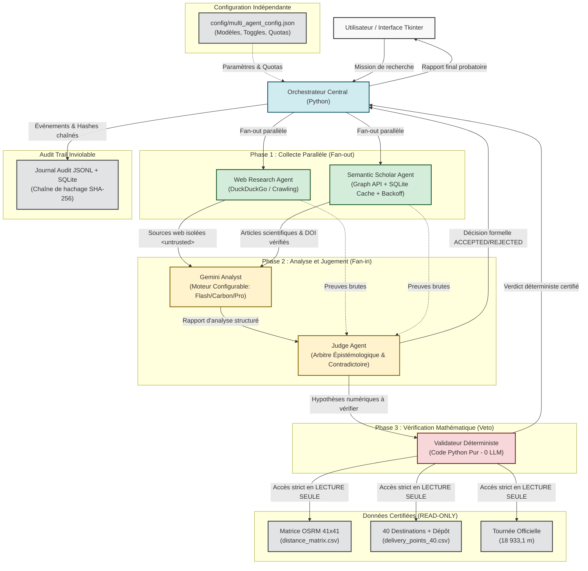
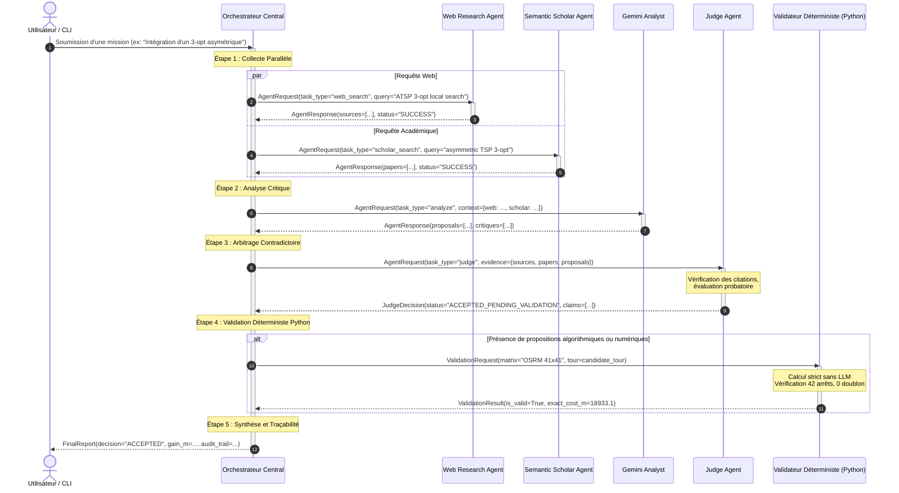

# RAPPORT OFFICIEL — PHASE 6.1
## Document 2 : Architecture Générale du Système Multi-Agents IA
**Projet :** AGADIR MAPPING — Last Mile TSP Optimization  
**Date d'audit :** 16/11/2026  
**Auteur :** Antigravity (Google DeepMind Team)  
**Classification :** Spécification Technique & Conception Système  

---

## 1. Philosophie et Principes Fondateurs

Le système multi-agents d'AGADIR MAPPING est guidé par un impératif épistémologique fondamental : **la primauté de la preuve vérifiable sur le consensus déclaratif**.

Contrairement aux architectures multi-agents classiques qui s'appuient sur un vote majoritaire entre plusieurs instances de LLM (susceptibles d'halluciner de concert sur des calculs combinatoires), notre architecture sépare rigoureusement :
1. **L'exploration floue et la recherche bibliographique :** Dévolues aux agents de recherche web et scientifiques ainsi qu'à l'analyste Gemini.
2. **Le raisonnement critique et l'arbitrage contradictoire :** Confiés à un Agent Juge spécialisé qui confronte les sources et les hypothèses.
3. **La vérification déterministe inviolable :** Exécutée en pur code Python par un composant hermétique, non-LLM, recalculant les distances, les coordonnées et les permutations sur la matrice OSRM 41x41 réelle.

---

## 2. Décomposition des Six Composants du Système

```text
┌────────────────────────────────────────────────────────────────────────┐
│                        UTILISATEUR / INTERFACE                         │
└───────────────────────────────────┬────────────────────────────────────┘
                                    │ Requête de Mission
                                    ▼
┌────────────────────────────────────────────────────────────────────────┐
│                    AGENT 6 — ORCHESTRATEUR CENTRAL                     │
│         Planification DAG, Routage, Synchronisation, Logging           │
└───────┬───────────────────────────┬────────────────────────────┬───────┘
        │ Déclenchement             │ Déclenchement              │
        ▼                           ▼                            │
┌───────────────────────────┐ ┌───────────────────────────┐      │
│  AGENT 1 : WEB RESEARCH   │ │ AGENT 2 : SEMANTIC SCHOLAR│      │
│ Collecte Web & Veille TSP │ │ Papiers académiques & DOI │      │
└─────────────┬─────────────┘ └─────────────┬─────────────┘      │
              │ Données brutes filtrées     │ Papiers indexés    │
              └──────────────┬──────────────┘                    │
                             ▼                                   │
              ┌───────────────────────────┐                      │
              │  AGENT 3 : GEMINI ANALYST │                      │
              │ Analyse critique & Thèses │                      │
              └──────────────┬────────────┘                      │
                             │ Propositions structurées          │
                             ▼                                   │
              ┌───────────────────────────┐                      │
              │   AGENT 4 : JUDGE AGENT   │                      │
              │ Évaluation des preuves    │                      │
              │ ACCEPTED/REJECTED/REVIEW  │                      │
              └──────────────┬────────────┘                      │
                             │ Hypothèses numériques             │
                             ▼                                   │
              ┌───────────────────────────┐                      │
              │  AGENT 5 : VALIDATEUR     │                      │
              │  DÉTERMINISTE (PYTHON)    │                      │
              │ Calcul strict OSRM 41x41  │                      │
              └──────────────┬────────────┘                      │
                             │ Verdict mathématique certifié     │
                             ▼                                   │
              ┌───────────────────────────┐                      │
              │  COLLECTEUR & RAPPORT     │◄─────────────────────┘
              └──────────────┬────────────┘
                             │ Rapport Final Traçable
                             ▼
┌────────────────────────────────────────────────────────────────────────┐
│                        UTILISATEUR / VALIDATION                        │
└────────────────────────────────────────────────────────────────────────┘
```

### Rôle des six agents :

1. **Agent 1 — Web Research Agent :** Explore le web technique pour identifier les innovations récentes, les bibliothèques d'optimisation et les benchmarks récents sur le Last-Mile TSP.
2. **Agent 2 — Semantic Scholar Agent :** Interroge l'Academic Graph pour extraire des articles scientifiques avec métadonnées formelles (titres, auteurs, résumé, DOI, citations) sur l'ATSP et les métaheuristiques hybrides. Gère explicitement le mode anonyme (pool partagé soumis au throttling global) et le mode authentifié (`x-api-key`), avec backoff exponentiel et cache persistant SQLite.
3. **Agent 3 — Gemini Analyst (Moteur IA Configurable) :** Synthétise les données des deux premiers agents, évalue la faisabilité théorique, détecte les angles morts et émet des propositions d'amélioration concrètes. Moteur entièrement découplé du code métier via configuration externe (modèle économique configurable par défaut, ex. `gemini-3.8-flash`, et modèle haute capacité sur demande explicite, ex. `gemini-4-carbon`, avec possibilité d'abstraction multi-fournisseurs).
4. **Agent 4 — Judge Agent :** Analyse contradictoirement les affirmations de l'Analyste au regard des sources. Assigne un statut (`ACCEPTED`, `REJECTED`, `NEEDS_REVIEW`) et un score de confiance probatoire.
5. **Agent 5 — Deterministic Validator (Python) :** Valide toute proposition touchant au calcul numérique ou à l'ordonnancement en recalculant les coûts exacts sur la matrice OSRM 41x41 certifiée en LECTURE SEULE stricte. Dispose d'un veto mathématique absolu.
6. **Agent 6 — Central Orchestrator :** Reçoit l'instruction utilisateur, génère le plan d'exécution DAG, coordonne les appels, gère les pannes/timeouts, maintient la chaîne de hachage SHA-256 de l'audit trail (JSONL + SQLite) et agrège le rapport final.

---

## 3. Topologie d'Orchestration : Comparaison et Recommandation

Nous avons étudié trois architectures de coordination possibles :

### A. Architecture Purement Séquentielle (Pipeline linéaire)
- *Principe :* Web $\to$ Scholar $\to$ Analyst $\to$ Judge $\to$ Validator.
- *Avantages :* Simplicité de mise en œuvre, débogage aisé.
- *Inconvénients :* Temps d'exécution doublé car les requêtes réseau externes (Web et Semantic Scholar) ne sont pas parallélisées ; blocage complet si une étape amont ralentit.

### B. Architecture Purement Parallèle (Fan-out / Fan-in complet)
- *Principe :* L'orchestrateur lance tous les agents en même temps et tente de fusionner les résultats.
- *Avantages :* Vitesse maximale en théorie.
- *Inconvénients :* L'Analyste et le Juge ont besoin des résultats de recherche pour travailler ; le parallélisme total introduit une désynchronisation cognitive et augmente le risque d'hallucinations.

### C. Architecture Recommandée : Pipeline Hybride DAG (Directed Acyclic Graph Conditionnel)
- *Principe :*
  - **Étape 1 (Parallèle / Fan-out) :** Lancement simultané de l'Agent Web Research et de l'Agent Semantic Scholar.
  - **Étape 2 (Jointure) :** Agrégation des sources et transmission à l'Agent Gemini Analyst.
  - **Étape 3 (Analyse & Confrontation) :** Transmission de l'analyse et des sources à l'Agent Judge.
  - **Étape 4 (Validation Conditionnelle) :** Si et seulement si le Judge valide une proposition impliquant des calculs numériques, déclenchement du Validateur Déterministe Python.
  - **Étape 5 (Restitution) :** Synthèse finale consolidée et enregistrement du rapport d'audit.

> [!TIP]
> **Décision d'architecture :** AGADIR MAPPING adopte l'**Architecture Hybride DAG Conditionnelle**, qui allie la rapidité de la collecte parallèle à la rigueur de la chaîne d'arbitrage séquentielle.

---

## 4. Diagramme Mermaid Général de l'Architecture



---

## 5. Diagramme Mermaid du Flux de Communication et d'Arbitrage



---

## 6. Cycle de Vie et États d'une Mission Multi-Agents

Toute mission gérée par l'Orchestrateur suit une machine à états finis stricte :

```text
[INITIATED] 
    │
    ▼
[RESEARCHING] ──(Timeout / Erreur)──► [RETRYING_RESEARCH] ──► [FAILED_RESEARCH]
    │                                                                  │
    ▼ (Succès Web & Scholar)                                           ▼
[ANALYZING] ────────────────────────► [ANALYSIS_ERROR] ───────► [ABORTED]
    │
    ▼ (Succès Analyste)
[JUDGING] ──────────────────────────► [REJECTED] ─────────────► [COMPLETED_WITH_REJECTION]
    │
    ▼ (Acceptation sous condition)
[VALIDATING] ───────────────────────► [MATH_VIOLATION] ───────► [REJECTED_UNFEASIBLE]
    │
    ▼ (Validation mathématique 100%)
[CONSOLIDATING] 
    │
    ▼
[COMPLETED_SUCCESS]
```

Cette structure garantit qu'aucune conclusion erronée ou non prouvée ne puisse atteindre l'utilisateur.
