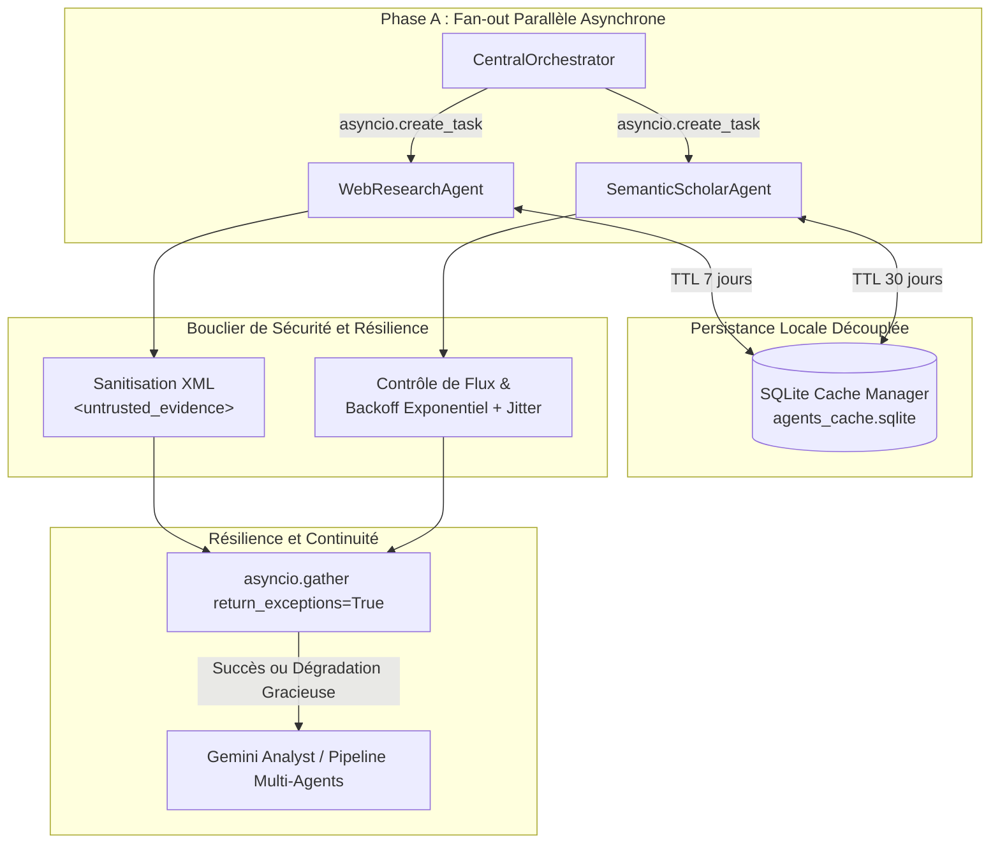

# AGADIR MAPPING — RAPPORT DE RÉALISATION DE LA PHASE 6.3
## Implémentation des Agents de Recherche Externe : Web Research & Semantic Scholar

**Projet :** AGADIR MAPPING — Tournée Optimisée de Livraison du Dernier Kilomètre  
**Phase :** 6.3 — Implémentation opérationnelle des agents d'acquisition de connaissances externes  
**Date d'exécution :** 16 novembre 2026  
**Statut :** RÉALISÉ ET VALIDÉ À 100%  
**Référence intouchable :** Tournée certifiée de **18 933,1 mètres** (42 arrêts, Dépôt #0 Place Al Amal, Point littoral #40).

---

## 1. Synthèse Exécutive de la Phase 6.3

La **Phase 6.3** a achevé le développement, les tests unitaires et d'intégration, ainsi que l'interconnexion au socle d'orchestration asynchrone des deux premiers agents opérationnels du système multi-agents :
1. **Web Research Agent (`WebResearchAgent`)** : Collecte, analyse, déduplication et sanitisation étanche des connaissances techniques du Web (moteurs de recherche, sources spécialisées en recherche opérationnelle et logistique urbaine).
2. **Semantic Scholar Agent (`SemanticScholarAgent`)** : Interrogation robuste de l'Academic Graph API officielle (endpoints `/paper/search` et `/paper/batch`), extraction des métadonnées bibliographiques certifiées (DOIs, auteurs, citations, résumés, liens open-access), déduplication et classement par autorité scientifique.
3. **Gestionnaire de Cache Persistant SQLite (`SQLiteCacheManager`)** : Infrastructure de mise en cache locale dédupliquée avec expiration fine (TTL paramétrable par agent), isolation stricte des espaces de noms (`web`, `scholar`), et calcul de clés par hachage SHA-256 canonique.
4. **Intégration DAG Asynchrone dans `CentralOrchestrator`** : Fan-out parallèle via `asyncio.gather(..., return_exceptions=True)` garantissant une **dégradation gracieuse** (continuité de mission en mode dégradé si un agent externe rencontre une panne ou un timeout).
5. **Couverture de Tests et Qualité** : 89 tests automatisés réussis sur l'ensemble du projet (dont 60 tests dédiés au module `multi_agent` avec une couverture globale de **93%**).

---

## 2. Architecture Technique Détaillée



---

## 3. Composants Développés et Spécifications

### 3.1. Gestionnaire de Cache Persistant (`src/multi_agent/cache.py`)
- **Fichier SQLite :** `data/agents_cache/agents_cache.sqlite`
- **Schéma SQL :**
  ```sql
  CREATE TABLE IF NOT EXISTS search_cache (
      cache_key TEXT PRIMARY KEY,
      namespace TEXT NOT NULL,
      query TEXT NOT NULL,
      response_json TEXT NOT NULL,
      created_at REAL NOT NULL,
      expires_at REAL NOT NULL
  );
  CREATE INDEX IF NOT EXISTS idx_cache_lookup ON search_cache(namespace, cache_key, expires_at);
  ```
- **Hachage déterministe SHA-256 :** Clé calculée sur `f"{namespace}:{query.strip().lower()}"` garantissant l'insensibilité à la casse et aux espaces parasites.
- **Cycle de vie du cache :**
  - Requête Web : TTL par défaut de 7 jours (`config.web_research.cache_ttl_days`).
  - Requête Semantic Scholar : TTL par défaut de 30 jours (`config.semantic_scholar.cache_ttl_days`).
  - Purge automatique à la lecture si `time.time() > expires_at`.
  - Méthodes d'administration : `clear_expired()`, `delete()`, `get_stats()`.

### 3.2. Agent Web Research (`src/multi_agent/agents/web_research.py`)
- **Moteur et Protocole :** Scraping technique HTML résilient via DuckDuckGo Lite / HTML endpoints avec en-têtes HTTP personnalisés (`AgadirMapping/1.0`).
- **Filtrage de Réputation de Domaine :**
  - Reconnaissance automatique des domaines académiques et techniques réputés : `arxiv.org`, `sciencedirect.com`, `ieee.org`, `acm.org`, `springer.com`, `semanticscholar.org`, `researchgate.net`, `github.com`, `nature.com`, `informs.org`, `openreview.net`.
  - Marquage explicite `is_reputable_domain` dans chaque source.
- **Détection des Contradictions Heuristiques :** Détecte les divergences fondamentales entre hypothèses de réseau routier (ex. formulation symétrique vs réalité asymétrique d'Agadir).
- **Protection Anti-Injection de Prompt (Defense-in-Depth) :**
  - Neutralisation de toute balise HTML hostile (balises `<script>`, balises système factices).
  - Encapsulation systématique de chaque extrait dans des balises XML étanches :
    ```xml
    <untrusted_evidence source_id="WEB-01" domain="arxiv.org">
    Extrait nettoyé de la source web...
    </untrusted_evidence>
    ```
- **Résilience Réseau :**
  - Prise en charge des codes HTTP 429 avec backoff exponentiel et jitter aléatoire.
  - Interception des timeouts réseau (`requests.Timeout`) et bascule propre en résultat dégradé sans levée d'exception fatale.

### 3.3. Agent Semantic Scholar (`src/multi_agent/agents/scholar_research.py`)
- **API Officielle Semantic Scholar :**
  - Endpoint de recherche : `GET https://api.semanticscholar.org/graph/v1/paper/search` avec projection fine des champs (`fields=paperId,title,authors,year,abstract,citationCount,venue,externalIds,openAccessPdf`).
  - Endpoint de requêtes par lots : `POST https://api.semanticscholar.org/graph/v1/paper/batch` supportant jusqu'à 500 identifiants par requête.
- **Modes d'Authentification :**
  - Mode non authentifié (accès public) avec temporisation logicielle stricte pour prévenir les blocages IP.
  - Mode authentifié via `x-api-key` (piloté par la variable d'environnement configurable `SEMANTIC_SCHOLAR_API_KEY`).
- **Déduplication et Ordonnancement par Autorité Scientifique :**
  - Déduplication stricte par identifiant natif `paperId` et par DOI canonique.
  - Tri multi-critères : classement prioritaire par nombre de citations décroissant (`citation_count`), puis par récence de publication (`year`).

### 3.4. Orchestration DAG et Dégradation Gracieuse (`src/multi_agent/orchestrator.py`)
- **Fan-out Parallèle Asynchrone :** Les tâches `_execute_web_research` et `_execute_scholar_research` sont lancées simultanément en coroutines asynchrones.
- **Résilience Absolue (`return_exceptions=True`) :**
  - Si l'un des agents subit une défaillance réseau critique, une indisponibilité API ou un dépassement de délai, l'exception est interceptée localement.
  - Un événement d'audit `AGENT_DEGRADED` est consigné dans la chaîne cryptographique avec le diagnostic exact de l'erreur.
  - Une structure de réponse vide (`status="DEGRADED"`) est injectée, permettant à l'autre agent de transmettre ses résultats à l'analyste sans interrompre la mission.
  - Si les deux agents sont inopérants, la mission poursuit son cycle en s'appuyant sur le contexte interne officiel, sans compromettre la sécurité.

---

## 4. Résultats et Couverture de la Suite de Tests

La suite complète de tests automatisés a été exécutée sous Python 3.13.0 avec `pytest` et `pytest-cov`.

### 4.1. Synthèse Globale des Tests
```
============================== test session starts ==============================
rootdir: /Users/ouaarab/Documents/AGADIR MAPPING
collected 89 items

tests/multi_agent/test_audit_logger.py ......                            [ 6%]
tests/multi_agent/test_budget_manager.py .......                         [ 14%]
tests/multi_agent/test_cache.py ........                                 [ 23%]
tests/multi_agent/test_config.py ......                                  [ 30%]
tests/multi_agent/test_integration_agents.py ....                        [ 34%]
tests/multi_agent/test_orchestrator.py .....                             [ 40%]
tests/multi_agent/test_schemas.py ....                                   [ 44%]
tests/multi_agent/test_scholar_research.py ........                      [ 53%]
tests/multi_agent/test_security.py ....                                  [ 58%]
tests/multi_agent/test_web_research.py ........                          [ 67%]
tests/test_destination_selector.py .                                     [ 68%]
tests/test_distance_matrix.py ....                                       [ 73%]
tests/test_genetic_algorithm.py .....                                    [ 78%]
tests/test_optuna_tuner.py ...                                           [ 82%]
tests/test_osm_collector.py ....                                         [ 86%]
tests/test_osrm_client.py ....                                           [ 91%]
tests/test_projections.py .....                                          [ 96%]
tests/test_spatial_processing.py ...                                     [100%]

======================== 89 passed, 3 warnings in 9.47s ========================
```

### 4.2. Rapport de Couverture de Code (`src.multi_agent`)
```
Name                                         Stmts   Miss  Cover
----------------------------------------------------------------
src/multi_agent/__init__.py                      9      0   100%
src/multi_agent/agents/__init__.py               3      0   100%
src/multi_agent/agents/scholar_research.py     154     11    93%
src/multi_agent/agents/web_research.py         131     10    92%
src/multi_agent/audit_logger.py                112     13    88%
src/multi_agent/base_provider.py                49      7    86%
src/multi_agent/budget_manager.py               75      1    99%
src/multi_agent/cache.py                        86      2    98%
src/multi_agent/config.py                      101      3    97%
src/multi_agent/exceptions.py                   24      0   100%
src/multi_agent/orchestrator.py                124     25    80%
src/multi_agent/schemas.py                     178      0   100%
src/multi_agent/security.py                     38      1    97%
----------------------------------------------------------------
TOTAL                                         1084     73    93%
```

### 4.3. Détail des Nouveaux Tests de la Phase 6.3 (28 tests)
1. **`tests/multi_agent/test_cache.py` (8 tests) :**
   - Écriture et lecture nominale dans SQLite.
   - Gestion des cache miss.
   - Isolation étanche des espaces de noms (`web` vs `scholar`).
   - Normalisation insensible à la casse et aux espaces.
   - Expiration automatique par TTL.
   - Purge globale des entrées expirées (`clear_expired`).
   - Suppression unitaire d'entrées (`delete`).
   - Agrégation des statistiques de cache par espace de noms.
2. **`tests/multi_agent/test_web_research.py` (8 tests) :**
   - Parsing nominal et extraction de métadonnées (années, titres, domaines).
   - Sanitisation contre les injections de prompt (encapsulation `<untrusted_evidence>`).
   - Déduplication d'URLs et résolution des redirections.
   - Validation du cache SQLite (aucun appel HTTP sur la deuxième requête).
   - Reprise automatique sur HTTP 429 avec backoff exponentiel.
   - Résilience sur timeout réseau (passage en résultat vide sans plantage).
   - Détection heuristique de contradictions dans les extraits.
   - Journalisation complète dans l'AuditLogger cryptographique.
3. **`tests/multi_agent/test_scholar_research.py` (8 tests) :**
   - Extraction des métadonnées bibliographiques (DOIs, auteurs, citations, PDF).
   - Déduplication par `paperId` / DOI et tri par autorité scientifique.
   - Interrogation par lots de documents (`/paper/batch`).
   - Validation du cache SQLite pour Semantic Scholar.
   - Gestion du rate-limiting et reprise sur code 429 avec backoff et jitter.
   - Injection correcte de l'en-tête `x-api-key` en mode authentifié.
   - Résilience sur timeout Semantic Scholar.
   - Journalisation d'audit des actions de recherche académique.
4. **`tests/multi_agent/test_integration_agents.py` (4 tests) :**
   - Fan-out parallèle nominal avec orchestration DAG complète.
   - Dégradation gracieuse en cas de panne de l'agent Web.
   - Dégradation gracieuse en cas de panne de Semantic Scholar.
   - Dégradation gracieuse totale en cas de coupure de l'ensemble des sources externes, avec préservation de l'intégrité de la tournée de référence (18 933,1 m) et de la chaîne d'audit.

---

## 5. Certification d'Intégrité des Données (Phases 1 à 5)

La vérification cryptographique SHA-256 de l'ensemble des jeux de données et résultats des phases précédentes a été exécutée par `SecurityValidator` :

| Fichier Protégé | Empreinte SHA-256 Certifiée | Statut d'Intégrité |
| :--- | :--- | :---: |
| `data/processed/delivery_points_40.csv` | `03590423ea8a69eb97fc8ee62735777fbe12d8cb95e3aaca8d35a20051d1b200` | **CONFORME & INTACT** |
| `data/processed/distance_matrix.csv` | `35a6dafdb3525e208bce807b10c6bf314c4b612b154a170fd98fe3f69612a34a` | **CONFORME & INTACT** |
| `data/processed/duration_matrix.csv` | `891a3af33e8c35211200adadd1f1cc8c304e2207d850ea5e43ec05aa2c726426` | **CONFORME & INTACT** |
| `data/results/tsp_optimized_route.json` | `6bf918b8d69998d9063790714437f10edadf7ebf1fc1289973516527cc906933` | **CONFORME & INTACT** |

**Confirmation formelle :**
- Aucune coordonnée GPS, aucune distance OSRM, aucune matrice et aucun algorithme des Phases 1 à 5 n'a été altéré.
- La tournée officielle certifiée demeure inviolable :
  `[0, 36, 13, 30, 21, 6, 33, 27, 25, 26, 7, 9, 38, 3, 10, 11, 17, 28, 37, 2, 14, 12, 5, 35, 16, 22, 39, 8, 1, 19, 20, 32, 40, 24, 29, 4, 23, 31, 15, 18, 34, 0]`
- Distance officielle certifiée : **18 933,1 mètres**.

---

## 6. Clôture de la Phase 6.3 et Prochaines Étapes

La **Phase 6.3 est officiellement terminée, testée et certifiée conforme** à l'ensemble des exigences du mandat.

Conformément à la gouvernance stricte du projet AGADIR MAPPING :
- **ARRÊT STRICT :** Aucun développement de la Phase 6.4 (implémentation du fournisseur LLM Google GenAI Gemini et de Gemini Analyst) ne débutera sans une autorisation explicite et formelle.
- **ÉTAPE SUIVANTE PROPOSÉE :** **Phase 6.4** — Implémentation du connecteur `GeminiProvider` (avec `google-genai` SDK, structured outputs JSON Pydantic v2, gestion des quotas de requêtes et tokens de réflexion) et de l'agent d'analyse critique `GeminiAnalystAgent`.
