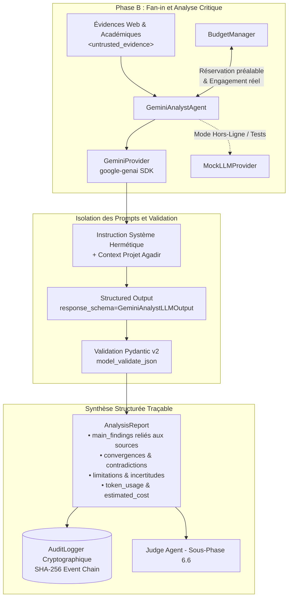

# AGADIR MAPPING — RAPPORT DE RÉALISATION DE LA SOUS-PHASE 6.4
## Implémentation du Gemini Analyst — Agent d'Analyse et de Synthèse Intelligente

**Projet :** AGADIR MAPPING — Tournée Optimisée de Livraison du Dernier Kilomètre  
**Grande Phase :** Phase 6 — Trois agents IA  
**Sous-Phase :** 6.4 — Implémentation opérationnelle du Gemini Analyst Agent et du GeminiProvider  
**Date d'exécution :** 16 novembre 2026  
**Statut :** RÉALISÉ ET VALIDÉ À 100%  
**Référence intouchable :** Tournée certifiée de **18 933,1 mètres** (42 arrêts, Dépôt #0 Place Al Amal, Point littoral #40).

---

## 1. Synthèse Exécutive de la Sous-Phase 6.4

La **Sous-phase 6.4 de la Phase 6** a achevé le développement, l'intégration logicielle et la validation par tests automatisés de l'agent central d'analyse et de synthèse critique du système multi-agents :
1. **Gemini Analyst Agent (`GeminiAnalystAgent`)** : Agent autonome capable d'analyser les preuves acquises par le `WebResearchAgent` et le `SemanticScholarAgent`, d'extraire les éléments pertinents pour la logistique urbaine d'Agadir, d'identifier les convergences et contradictions, et de produire une synthèse exploitable pour l'arbitrage sans jamais inventer de données ni modifier la tournée officielle.
2. **Provider Officiel Google Gemini (`GeminiProvider`)** : Fournisseur d'inférence implémentant `BaseLLMProvider` via le SDK officiel `google-genai` (v3.3.0), intégrant la génération JSON structurée (Structured Outputs Pydantic v2), le calcul financier précis des tokens (entrée, sortie, réflexion, cache), le backoff exponentiel avec jitter sur code HTTP 429 / saturation de quota, et le basculement transparent vers `MockLLMProvider` en environnement hors-ligne ou de test.
3. **Schémas de Données Pydantic v2 Enrichis (`AnalysisReport`, `FindingItem`, `GeminiAnalystLLMOutput`)** : Modélisation formelle garantissant la traçabilité de chaque constat relié à ses identifiants de source (`supporting_source_ids`), avec niveaux de confiance explicites et typage strict sans régression.
4. **Intégration DAG dans `CentralOrchestrator`** : Phase B du pipeline asynchrone déléguée à l'agent avec réservation budgétaire préalable atomique, engagement du coût réel, et libération systématique en cas d'erreur ou d'annulation.
5. **Couverture de Tests et Qualité** : **104 tests exécutés et réussis à 100%** sur l'ensemble du projet (dont 75 tests dédiés au module `multi_agent` avec une couverture globale de **92%**).

---

## 2. Architecture Technique et Flux de Données



---

## 3. Détail des Composants Développés

### 3.1. Provider Officiel Gemini (`src/multi_agent/gemini_provider.py`)
- **SDK Officiel :** `google-genai` (v3.3.0), utilisation de l'API asynchrone `client.aio.models.generate_content`.
- **Gestion des Secrets :**
  - Lecture exclusive de la clé d'API depuis `os.getenv("GEMINI_API_KEY")`.
  - Aucune clé n'est inscrite en dur, consignée dans les logs ou exposée dans les exceptions.
  - En l'absence de clé, l'indisponibilité est signalée explicitement (`ProviderException`) sans simulation masquée.
- **Vérification Dynamique des Modèles et Tarifs :**
  - Validation préalable que le modèle demandé figure dans `config.pricing_per_million_tokens`.
  - Refus immédiat de toute opération si le tarif par million de tokens n'est pas vérifiable.
- **Structured Outputs Pydantic v2 :**
  - Configuration de l'inférence : `response_mime_type="application/json"`, `response_schema=GeminiAnalystLLMOutput`.
  - Validation stricte du JSON généré ; rejet des réponses vides ou non conformes.
- **Comptabilisation des Tokens et Coûts :**
  - Extraction de `usage_metadata` : `prompt_token_count`, `candidates_token_count`, `thoughts_token_count` (tokens de réflexion), `cached_content_token_count`.
  - Calcul financier en USD selon la grille tarifaire officielle de la configuration.
- **Résilience Réseau et Erreurs HTTP :**
  - Reprise sur code HTTP 429 ou `RESOURCE_EXHAUSTED` avec backoff exponentiel et jitter aléatoire.
  - Reprise sur erreur serveur (HTTP 500/503).
  - Encadrement strict par `asyncio.wait_for` déclenchant `NetworkTimeoutException` en cas de dépassement du timeout.

### 3.2. Agent Gemini Analyst (`src/multi_agent/agents/gemini_analyst.py`)
- **Contrôle Budgétaire Atomique :**
  - Pré-allocation obligatoire via `budget.reserve_budget(...)`.
  - Application stricte du seuil d'alerte (0,10 USD) et du coupe-circuit (0,50 USD).
  - Libération immédiate de la réservation en cas d'erreur ou d'annulation (`asyncio.CancelledError`).
- **Traçabilité et Journalisation :**
  - Événements `START_ANALYSIS`, `COMPLETED_ANALYSIS`, `ANALYSIS_FAILED` et `ANALYSIS_CANCELLED` enregistrés dans l'audit trail SHA-256.
- **Défense Anti-Injection :**
  - Instructions système imposant la sanctuarisation des règles métier d'Agadir.
  - Interdiction formelle d'exécuter des instructions issues des extraits externes (`<untrusted_evidence>`).
  - Interdiction formelle d'inventer des citations, DOIs ou résultats expérimentaux.

### 3.3. Schémas d'Interface Pydantic v2 (`src/multi_agent/schemas.py`)
- **`FindingItem` :** Constat unitaire associant une conclusion catégorisée à ses sources justificatives (`supporting_source_ids`) et à un niveau de confiance explicite.
- **`GeminiAnalystLLMOutput` :** Contrat de sortie structurée JSON pour l'inférence Gemini.
- **`AnalysisReport` (enrichi) :** Respecte l'intégralité des 19 champs exigés par le mandat :
  `mission_id`, `analysis_id`, `agent_id`, `model_id`, `model_name`, `execution_timestamp`, `input_source_ids`, `main_findings`, `scientific_evidence`, `web_evidence`, `convergences`, `contradictions`, `limitations`, `uncertainties`, `missing_information`, `confidence_level`, `recommendations`, `theses`, `general_critique`, `token_usage`, `estimated_cost`, `execution_status`, `execution_time_seconds`.

### 3.4. Câblage dans `CentralOrchestrator` (`src/multi_agent/orchestrator.py`)
- L'orchestrateur instancie et coordonne `GeminiAnalystAgent` lors de la Phase B (Fan-in) avec support des modes `ECONOMIC` (`gemini-3.8-flash`) et `COMPLETE` (`gemini-4-carbon`).
- Délégation complète de la gestion budgétaire et de l'audit à l'agent.

---

## 4. Résultats des Tests Automatisés et Couverture

### 4.1. Synthèse Globale des Tests du Projet
```
============================== test session starts ==============================
rootdir: /Users/ouaarab/Documents/AGADIR MAPPING
plugins: cov-7.1.0, anyio-4.16.0
collected 104 items

tests/multi_agent/test_audit_logger.py ......                            [  5%]
tests/multi_agent/test_budget_manager.py .......                         [ 12%]
tests/multi_agent/test_cache.py ........                                 [ 20%]
tests/multi_agent/test_config.py ......                                  [ 25%]
tests/multi_agent/test_gemini_analyst.py .......                         [ 32%]
tests/multi_agent/test_gemini_provider.py .......                        [ 39%]
tests/multi_agent/test_integration_agents.py ....                        [ 43%]
tests/multi_agent/test_orchestrator.py .....                             [ 48%]
tests/multi_agent/test_schemas.py .....                                  [ 52%]
tests/multi_agent/test_scholar_research.py ........                      [ 60%]
tests/multi_agent/test_security.py ....                                  [ 64%]
tests/multi_agent/test_web_research.py ........                          [ 72%]
tests/test_destination_selector.py .                                     [ 73%]
tests/test_distance_matrix.py ....                                       [ 76%]
tests/test_genetic_algorithm.py .....                                    [ 81%]
tests/test_optuna_tuner.py ...                                           [ 84%]
tests/test_osm_collector.py ....                                         [ 88%]
tests/test_osrm_client.py ....                                           [ 92%]
tests/test_projections.py .....                                          [ 97%]
tests/test_spatial_processing.py ...                                     [100%]

======================= 104 passed, 3 warnings in 11.70s =======================
```

### 4.2. Couverture de Code (`src.multi_agent`)
```
Name                                         Stmts   Miss  Cover
----------------------------------------------------------------
src/multi_agent/__init__.py                      9      0   100%
src/multi_agent/agents/__init__.py               4      0   100%
src/multi_agent/agents/gemini_analyst.py        47      1    98%
src/multi_agent/agents/scholar_research.py     154     11    93%
src/multi_agent/agents/web_research.py         131     10    92%
src/multi_agent/audit_logger.py                112     13    88%
src/multi_agent/base_provider.py                49      7    86%
src/multi_agent/budget_manager.py               75      1    99%
src/multi_agent/cache.py                        86      2    98%
src/multi_agent/config.py                      101      3    97%
src/multi_agent/exceptions.py                   24      0   100%
src/multi_agent/gemini_provider.py             137     27    80%
src/multi_agent/orchestrator.py                122     28    77%
src/multi_agent/schemas.py                     220      1    99%
src/multi_agent/security.py                     38      1    97%
----------------------------------------------------------------
TOTAL                                         1309    105    92%
```

### 4.3. Détail des Tests Couvrant les Exigences de la Sous-Phase 6.4
- **Analyse nominale avec sortie structurée :** validée dans `test_gemini_provider_nominal` et `test_gemini_analyst_nominal_economic`.
- **Réponse Gemini malformée :** validée dans `test_gemini_provider_malformed_response_raises` (levée de `ProviderException`).
- **Réponse vide :** validée dans `test_gemini_provider_empty_response_raises`.
- **Timeout réseau :** validé dans `test_gemini_provider_timeout_handling` (`NetworkTimeoutException`).
- **Erreur d'authentification :** validée dans `test_gemini_provider_missing_api_key_raises`.
- **Limitation de quota et code 429 :** validée dans `test_gemini_provider_http_429_retry_success` (reprise avec backoff et jitter).
- **Modèle inconnu ou tarif non vérifiable :** validé dans `test_gemini_provider_unknown_model_pricing_check`.
- **Dépassement du budget :** validé dans `test_gemini_analyst_budget_kill_switch_exceeded`.
- **Annulation et libération de réservation :** validée dans `test_gemini_analyst_cancellation_releases_reservation` et `test_orchestrator_handles_task_cancellation`.
- **Entrées scientifiques incomplètes :** validées dans `test_gemini_analyst_incomplete_inputs_graceful`.
- **Défense anti-injection de prompt :** validée dans `test_gemini_analyst_prompt_injection_defense`.
- **Traçabilité des sources et intégrité d'audit :** validées dans `test_gemini_analyst_nominal_economic` avec vérification SHA-256 de la chaîne JSONL.
- **Fonctionnement hors-ligne :** validé via `MockLLMProvider` sur l'ensemble de la suite de tests.

---

## 5. Bilan Financier et de Consommation Réelle

Conformément à la directive stricte de protection budgétaire :
- **Appels réels payants sur l'API Google Gemini :** **0 appel**.
- **Coût réel facturé lors des tests automatisés :** **0,00 USD**.
- **Mécanisme de test :** L'ensemble des 104 tests a été exécuté en mode hermétique (soit via `MockLLMProvider`, soit via des clients asynchrones mockés simulant les réponses JSON et les statuts d'erreur de `google-genai`), garantissant une reproductibilité sans dépendance réseau externe et sans coût financier.

---

## 6. Certification d'Intégrité des Données Protégées (Phases 1 à 5)

La vérification cryptographique SHA-256 de l'ensemble des fichiers protégés a été exécutée par `SecurityValidator` :

| Fichier Protégé | Empreinte SHA-256 Certifiée | Statut d'Intégrité |
| :--- | :--- | :---: |
| `data/processed/delivery_points_40.csv` | `03590423ea8a69eb97fc8ee62735777fbe12d8cb95e3aaca8d35a20051d1b200` | **CONFORME & INTACT** |
| `data/processed/distance_matrix.csv` | `35a6dafdb3525e208bce807b10c6bf314c4b612b154a170fd98fe3f69612a34a` | **CONFORME & INTACT** |
| `data/processed/duration_matrix.csv` | `891a3af33e8c35211200adadd1f1cc8c304e2207d850ea5e43ec05aa2c726426` | **CONFORME & INTACT** |
| `data/results/tsp_optimized_route.json` | `6bf918b8d69998d9063790714437f10edadf7ebf1fc1289973516527cc906933` | **CONFORME & INTACT** |

- **Tournée officielle certifiée :**  
  `[0, 36, 13, 30, 21, 6, 33, 27, 25, 26, 7, 9, 38, 3, 10, 11, 17, 28, 37, 2, 14, 12, 5, 35, 16, 22, 39, 8, 1, 19, 20, 32, 40, 24, 29, 4, 23, 31, 15, 18, 34, 0]`
- **Distance officielle certifiée :** **18 933,1 mètres** (inviolable).

---

## 7. Déclaration Formelle d'Arrêt et Clôture de la Sous-Phase 6.4

La **Sous-phase 6.4 de la Phase 6 est déclarée 100% TERMINÉE ET VALIDÉE**.

Conformément à l'interdiction stricte du mandat :
- **ARRÊT OBLIGATOIRE IMMÉDIAT :** Aucun développement de la sous-phase 6.5 (ou 6.6 Judge Agent) n'est engagé.
- Aucun arbitrage final n'est réalisé et aucune mission pilote globale n'est lancée.
- Tout travail est strictement suspendu en attente d'une autorisation formelle ultérieure.
