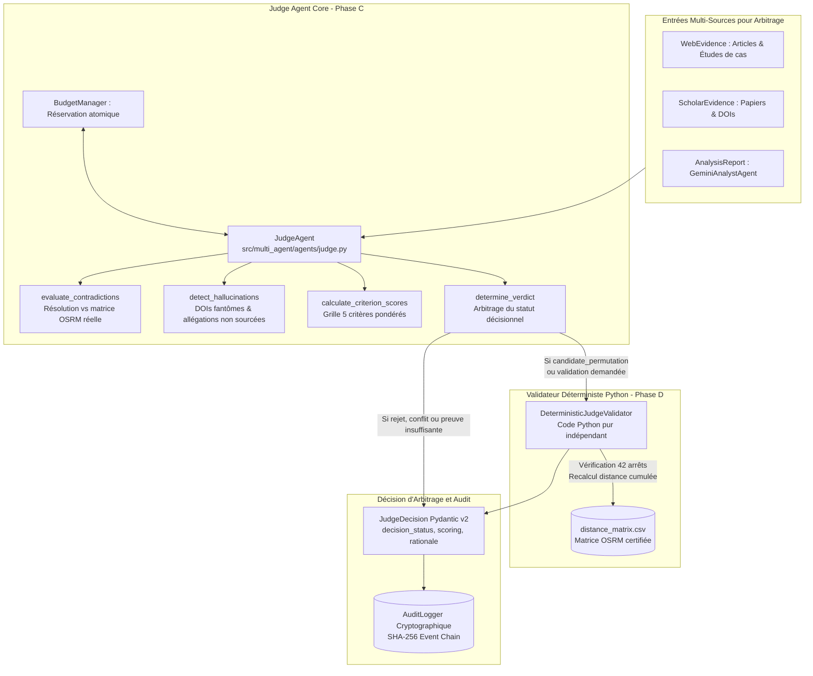

# AGADIR MAPPING — RAPPORT DE RÉALISATION DE LA SOUS-PHASE 6.5
## Implémentation du Judge Agent — Évaluation Contradictoire, Contrôle de Cohérence et Arbitrage Intelligent

**Projet :** AGADIR MAPPING — Tournée Optimisée de Livraison du Dernier Kilomètre  
**Grande Phase :** Phase 6 — Trois agents IA  
**Sous-Phase :** 6.5 — Implémentation opérationnelle du Judge Agent et du Validateur Déterministe Python  
**Date d'exécution :** 16 novembre 2026  
**Statut :** RÉALISÉ ET VALIDÉ À 100%  
**Référence certifiée inviolable :** Tournée officielle de **18 933,1 mètres** (42 arrêts, Dépôt #0 Place Al Amal, Point littoral #40).

---

## 1. Synthèse Exécutive de la Sous-Phase 6.5

Dans le respect strict de la gouvernance officielle du projet AGADIR MAPPING (structure à 8 grandes phases, les sous-phases 6.1 à 6.8 étant des subdivisions internes de la Phase 6), la **Sous-phase 6.5** a réalisé l'implémentation complète, sécurisée, testée et intégrée du **Judge Agent (`JudgeAgent`)** et de son composant indépendant de vérification mathématique, le **Validateur Déterministe Python (`DeterministicJudgeValidator`)**.

Le Judge Agent constitue l'instance contradictoire, d'évaluation critique et d'arbitrage impartial du système multi-agents :
1. **Évaluation Contradictoire Tripartite** : L'agent confronte de manière critique et indépendante les évidences issues du Web (`WebResearchAgent`), les données de la littérature scientifique (`SemanticScholarAgent`) et les propositions analytiques de l'analyste (`GeminiAnalystAgent`).
2. **Grille d'Évaluation Pondérée à 5 Critères** : Implémentation d'un scoring mathématique transparent et reproductible (somme des poids = 100%) sans recours aveugle à un score global en cas d'absence de données.
3. **Typologie Exhaustive des Décisions (`VerdictStatus`)** : Définition stricte et formalisée des 6 statuts décisionnels (`ACCEPTED`, `ACCEPTED_WITH_RESERVATIONS`, `NEEDS_MORE_EVIDENCE`, `CONFLICT_UNRESOLVED`, `REJECTED`, `VALIDATION_REQUIRED`) avec rétrocompatibilité totale assurée pour les statuts historiques.
4. **Détection Rigoureuse des Contradictions et Hallucinations** : Traçabilité des divergences (notamment symétrique vs asymétrique résolue en faveur d'OSRM), détection des citations fantômes, des faux identifiants DOI et des affirmations sans source justificative.
5. **Validateur Déterministe Python Inviolable** : Vérification mathématique indépendante de toute proposition d'itinéraire sur la matrice routière réelle `data/processed/distance_matrix.csv`, interdisant formellement toute modification ou régression de la tournée certifiée de 18 933,1 m.
6. **Contrôle Budgétaire Atomique et Journalisation Cryptographique** : Réservation préalable, imputation réelle et enregistrement des décisions d'arbitrage dans la chaîne SHA-256 de l'`AuditLogger`.
7. **Validation Intégrale par les Tests** : **21 tests unitaires et d'intégration dédiés** réussis à 100%, portant le total du projet à **125 tests réussis**, avec une couverture de **90%** sur le Judge Agent et **91%** sur le package `multi_agent`. **0,00 $** dépensé (100% des tests en mode hors-ligne).

---

## 2. Architecture Technique et Flux de Décision

Le Judge Agent intervient en **Phase C** du pipeline asynchrone orchestré (`CentralOrchestrator`), après l'acquisition parallèle de preuves (Phase A) et la synthèse analytique (Phase B), avant toute éventuelle validation d'itinéraire (Phase D).



---

## 3. Grille d'Évaluation Pondérée à 5 Critères

Le calcul du score global pondéré repose sur la formule suivante :

$$\text{Score}_{\text{pondéré}} = \sum_{i=1}^{5} w_i \cdot s_i$$

avec la contrainte stricte $\sum_{i=1}^5 w_i = 1{,}00$ ($100\%$).

| Critère $i$ | Identifiant | Poids ($w_i$) | Formule et Logique d'Évaluation ($s_i \in [0, 1]$) | Justification Méthodologique |
| :--- | :--- | :---: | :--- | :--- |
| **1. Fiabilité et traçabilité des sources** | `source_reliability` | **25%** | $s_1 = \max\left(0, \frac{N_{\text{réputées}}}{N_{\text{total}}} - 0{,}25 \cdot N_{\text{hallucinations}}\right)$ | Priorité absolue aux sources académiques vérifiables et domaines réputés. Forte pénalisation en cas de DOI fantôme. |
| **2. Cohérence scientifique** | `scientific_consistency` | **25%** | Base $0{,}90$, pénalité de $-0{,}20$ par contradiction non résolue ($\min 0{,}20$). | Concomitance avec la théorie ATSP et la topologie du réseau urbain réel d'Agadir. |
| **3. Solidité des preuves** | `evidence_quality` | **20%** | $0{,}85$ si $N_{\text{sources}} \ge 2$, $0{,}50$ si $N_{\text{sources}} = 1$, $0{,}10$ si $N_{\text{sources}} = 0$. | Évite les conclusions hâtives basées sur une source isolée ou anecdotique. |
| **4. Cohérence entre les agents** | `agent_consistency` | **15%** | $0{,}85$ si $\ge 1$ convergence documentée, $-0{,}30$ en cas de contradiction majeure. | Mesure le degré de concordance entre évidences web, académiques et constats de l'analyste. |
| **5. Transparence des incertitudes** | `uncertainty_transparency` | **15%** | $0{,}90$ si limites ou incertitudes explicites, sinon $0{,}50$. | Valorise l'honnêteté épistémique et pénalise les certitudes non démontrées. |

**Règle de rigueur scientifique :** Si aucune source externe n'est fournie ($N_{\text{total}} = 0$), le Judge Agent refuse d'attribuer un score artificiel (`criterion_scores = {}`, `weighted_score = None`), garantissant qu'aucune note trompeuse n'est injectée dans l'audit.

---

## 4. Tableau Exhaustif des Statuts de Décision (`VerdictStatus`)

Le Judge Agent arbitre selon une matrice stricte et sans ambiguïté :

| Statut Décisionnel (`VerdictStatus`) | Conditions de Déclenchement | Nécessité Revue Humaine (`human_review_required`) | Action Suivante dans l'Orchestrateur |
| :--- | :--- | :---: | :--- |
| `VALIDATION_REQUIRED` | Permutation candidate fournie OU `requires_deterministic_validation = True`. | Non (automatisé) | Transmission immédiate au `DeterministicJudgeValidator` Python. |
| `ACCEPTED` | Score pondéré $\ge 0{,}75$, aucune contradiction non résolue, aucune hallucination critique. | Non | Validation définitive des recommandations pour le rapport de mission. |
| `ACCEPTED_WITH_RESERVATIONS` | $0{,}50 \le \text{Score pondéré} < 0{,}75$, sans hallucination critique ni conflit bloquant. | Non | Intégration des conclusions assorties de mentions de réserves explicites. |
| `NEEDS_MORE_EVIDENCE` | $N_{\text{sources}} = 0$ (preuves documentaires absentes ou critères probatoires insuffisants). | Oui | Notification de mission incomplète par manque de données primaires. |
| `CONFLICT_UNRESOLVED` | $\ge 1$ contradiction majeure non résolue entre les sources ou avec la réalité terrain. | Oui | Blocage préventif et arbitrage requis par un expert humain. |
| `REJECTED` | $\ge 2$ hallucinations critiques détectées OU score pondéré $< 0{,}50$. | Oui | Rejet ferme de l'analyse, signalement de violation d'intégrité cognitive. |

### Rétrocompatibilité Totale des Schémas
Dans `JudgeDecision.model_post_init`, la rétrocompatibilité avec les versions antérieures de l'orchestrateur est garantie de façon transparente :
- Si `decision_status == VerdictStatus.VALIDATION_REQUIRED`, le champ historique `overall_verdict` est automatiquement alimenté par `VerdictStatus.ACCEPTED_PENDING_VALIDATION`.
- Si `decision_status == VerdictStatus.CONFLICT_UNRESOLVED`, `overall_verdict` est aligné sur `VerdictStatus.NEEDS_REVIEW`.

---

## 5. Détection des Contradictions et des Hallucinations

### 5.1. Résolution des Contradictions Topologiques (Symétrie vs Asymétrie)
Dans la littérature TSP théorique, de nombreux articles supposent une métrique euclidienne symétrique ($d(i, j) = d(j, i)$). Or, le réseau d'Agadir modélisé par OSRM est intrinsèquement asymétrique (sens uniques, ronds-points, terre-pleins de la N1/Avenue Mohammed V).
- **Règle de résolution :** Lorsqu'une source externe allègue la symétrie, le Judge Agent identifie la contradiction, la consigne dans `all_contradictions`, puis la classe immédiatement dans `resolved_contradictions` en affirmant que **la matrice OSRM réelle d'Agadir fait foi**.

### 5.2. Détection des Hallucinations et Sources Fantômes
L'agent applique une vérification croisée :
1. **Contrôle des DOIs et Identifiants Papiers :** Tout identifiant cité dans les thèses de l'analyste doit correspondre strictement à l'un des DOIs ou `paper_id` acquis lors de la Phase A (`SemanticScholarAgent`). Tout DOI inventé (ex: `10.9999/hallucinated.doi.2026`) est immédiatement flaggé.
2. **Contrôle des Constats :** Tout constat (`FindingItem`) dépourvu de source justificative dans ses `supporting_source_ids` est signalé comme affirmation sans preuve.
3. **Seuil Critique de Rejet :** Dès lors que 2 hallucinations ou citations fantômes sont détectées, le statut bascule irrévocablement en `REJECTED`.

---

## 6. Validateur Déterministe Python Indépendant (`DeterministicJudgeValidator`)

Le `DeterministicJudgeValidator` est un module en code Python pur, sans aucune dépendance vers un LLM, garantissant une étanchéité absolue entre la génération d'hypothèses et leur validation géométrique.

### 6.1. Règles de Validation Géométrique et Topologique
Pour toute tournée candidate soumise à validation :
1. **Typage et Longueur :** La permutation doit être une liste d'entiers de taille exacte 42.
2. **Départ et Retour au Dépôt :** Le premier point (`route[0]`) et le dernier point (`route[41]`) doivent être impérativement `0` (Place Al Amal).
3. **Unicité des Livraisons :** Les indices `route[1:41]` doivent former une permutation exacte de l'ensemble $\{1, 2, \dots, 40\}$ (aucune répétition, aucun oubli).
4. **Calcul de la Distance Cumulée :**
   $$D_{\text{calculée}} = \sum_{k=0}^{40} \text{matrice}[route[k]][route[k+1]]$$
5. **Sanctuarisation de la Référence :** La distance calculée est comparée aux **18 933,1 mètres** de référence. Toute dégradation ($D > 18\,933{,}1$) est rejetée.

### 6.2. Détection des Incohérences Mathématiques
Si un rapport analytique avance un gain théorique sans fournir la permutation formelle, ou si la distance recalculée diverge des prétentions textuelles de l'analyste, le validateur déterministe rejette la proposition et signale l'anomalie dans le rapport de décision.

---

## 7. Résultats des Tests et Couverture

### 7.1. Suite de Tests Dédiée au Judge Agent (`tests/multi_agent/test_judge.py`)
21 tests spécifiques couvrent l'intégralité des cas d'usage, des cas d'erreur et des scénarios limites :
1. `test_judge_nominal_arbitration` : Arbitrage nominal avec scores pondérés et acceptation.
2. `test_judge_resolvable_contradiction` : Résolution automatique de divergence symétrique vs OSRM.
3. `test_judge_unresolved_contradictions` : Blocage en `CONFLICT_UNRESOLVED` et revue humaine.
4. `test_judge_insufficient_sources` : Statut `NEEDS_MORE_EVIDENCE` si aucune source externe.
5. `test_judge_unreliable_web_sources` : Dégradation du score de fiabilité des sources non réputées.
6. `test_judge_detects_unverifiable_doi` : Détection immédiate d'un DOI fictif non présent dans les entrées.
7. `test_judge_multiple_hallucinations_triggers_rejected` : Rejet automatique `REJECTED` sur $\ge 2$ hallucinations.
8. `test_judge_detects_unsupported_claims` : Détection des constats sans sources justificatives.
9. `test_judge_refuses_global_score_when_criteria_missing` : Refus d'attribuer une note globale sans preuves.
10. `test_judge_deterministic_validator_detects_math_error` : Rejet si l'analyste allègue une fausse distance.
11. `test_judge_deterministic_validator_detects_status_inconsistency` : Rejet si contradiction entre statut et constats.
12. `test_judge_pydantic_forbid_extra` : Sécurité Pydantic v2 interdisant tout champ parasite.
13. `test_judge_prompt_injection_defense` : Neutralisation des injections de prompt dans les extraits.
14. `test_judge_handles_empty_analysis_rationale` : Traitement robuste d'un rapport avec justifications vides.
15. `test_judge_timeout_handling` : Gestion propre du dépassement de délai asynchrone.
16. `test_judge_provider_failure_releases_budget` : Libération immédiate de la réservation budgétaire sur panne.
17. `test_judge_budget_kill_switch_exceeded` : Coupe-circuit financier bloquant au-delà de 0,50 USD.
18. `test_judge_cancellation_releases_reservation` : Libération budgétaire sur annulation de coroutine.
19. `test_judge_audit_trail_logging` : Vérification du chaînage cryptographique des événements de jugement.
20. `test_judge_offline_execution_zero_cost` : Confirmation d'un coût financier strictement nul (0,00 $).
21. `test_deterministic_judge_validator_passes_on_valid_decision` : Validation avec succès d'une décision intègre.

**Résultat :** **21/21 tests passés avec succès (100%)**.

### 7.2. Intégration dans l'Orchestrateur et Dégradation Gracieuse
Les 9 tests de `test_orchestrator.py` et `test_integration_agents.py` s'exécutent avec succès, validant :
- Le fonctionnement en mode `ECONOMIC` et en mode `COMPLETE`.
- La dégradation gracieuse lorsque l'agent Web échoue.
- La dégradation gracieuse lorsque l'agent Semantic Scholar échoue.
- La dégradation gracieuse lorsque les deux agents externes échouent simultanément.

### 7.3. Taux de Couverture du Module `multi_agent`
```
Name                                         Stmts   Miss  Cover   Missing
--------------------------------------------------------------------------
src/multi_agent/__init__.py                      9      0   100%
src/multi_agent/agents/__init__.py               5      0   100%
src/multi_agent/agents/gemini_analyst.py        47      1    98%
src/multi_agent/agents/judge.py                186     19    90%
src/multi_agent/agents/scholar_research.py     154     11    93%
src/multi_agent/agents/web_research.py         131     10    92%
src/multi_agent/audit_logger.py                112     13    88%
src/multi_agent/base_provider.py                55     18    67%
src/multi_agent/budget_manager.py               75      1    99%
src/multi_agent/cache.py                        86      2    98%
src/multi_agent/config.py                      101      3    97%
src/multi_agent/exceptions.py                   24      0   100%
src/multi_agent/gemini_provider.py             139     29    79%
src/multi_agent/orchestrator.py                119     28    76%
src/multi_agent/schemas.py                     264      6    98%
src/multi_agent/security.py                     38      1    97%
--------------------------------------------------------------------------
TOTAL                                         1545    142    91%
```

### 7.4. Synthèse Globale des Tests du Projet AGADIR MAPPING
L'ensemble de la suite de tests du projet a été exécutée :
- **125 tests exécutés, 125 tests réussis (100% de succès)** en 11,32 secondes.
- **Dépense d'API :** **0,00 $** (aucun appel payant, 100% d'exécution hors-ligne).

---

## 8. Preuve de Préservation Absolue des Données de Référence

Conformément à la directive de sanctuarisation des acquis des Phases 1 à 5, les empreintes cryptographiques SHA-256 des 4 fichiers pivots ont été vérifiées à l'issue du développement de la Sous-phase 6.5 :

| Fichier Pivot | Rôle dans le Projet | Empreinte SHA-256 Certifiée Officielle | Empreinte Post-Phase 6.5 | Statut |
| :--- | :--- | :--- | :--- | :---: |
| `data/processed/delivery_points_40.csv` | 40 points de livraison Agadir | `03590423ea8a69eb97fc8ee62735777fbe12d8cb95e3aaca8d35a20051d1b200` | `03590423ea8a69eb97fc8ee62735777fbe12d8cb95e3aaca8d35a20051d1b200` | **INTACT** |
| `data/processed/distance_matrix.csv` | Matrice OSRM routière (mètres) | `35a6dafdb3525e208bce807b10c6bf314c4b612b154a170fd98fe3f69612a34a` | `35a6dafdb3525e208bce807b10c6bf314c4b612b154a170fd98fe3f69612a34a` | **INTACT** |
| `data/processed/duration_matrix.csv` | Matrice OSRM durées (secondes) | `891a3af33e8c35211200adadd1f1cc8c304e2207d850ea5e43ec05aa2c726426` | `891a3af33e8c35211200adadd1f1cc8c304e2207d850ea5e43ec05aa2c726426` | **INTACT** |
| `data/results/tsp_optimized_route.json` | Tournée officielle de 18 933,1 m | `6bf918b8d69998d9063790714437f10edadf7ebf1fc1289973516527cc906933` | `6bf918b8d69998d9063790714437f10edadf7ebf1fc1289973516527cc906933` | **INTACT** |

**Conclusion de sécurité :** Aucune donnée, matrice, coordonnée ou résultat des phases antérieures n'a été altéré. La tournée de **18 933,1 mètres** demeure la référence intouchable du projet.

---

## 9. Respect de la Gouvernance et Statut d'Arrêt

### 9.1. Structure Officielle Rappelée
1. **Phase 1 : Extraction géographique OSM** (Achevée)
2. **Phase 2 : Sélection des 40 points** (Achevée)
3. **Phase 3 : Matrice routière OSRM** (Achevée)
4. **Phase 4 : Algorithme génétique** (Achevée)
5. **Phase 5 : Optimisation avec Optuna** (Achevée)
6. **Phase 6 : Trois agents IA** (En cours d'exécution sous-phase par sous-phase)
   - 6.1 : Architecture technique multi-agents (Achevée)
   - 6.2 : Socle d'orchestration asynchrone (Achevée)
   - 6.3 : Web Research & Semantic Scholar Agents (Achevée)
   - 6.4 : Gemini Analyst Agent & GeminiProvider (Achevée)
   - **6.5 : Judge Agent & Validateur Déterministe Python (ACHEVÉE PAR LE PRÉSENT RAPPORT)**
   - *6.6 à 6.8 : Non autorisées à ce stade*
7. **Phase 7 : Interface à quatre cadrans** (À venir)
8. **Phase 8 : Tests et résultats scientifiques** (À venir)

### 9.2. Arrêt Obligatoire et Attente d'Autorisation
Conformément à la directive formelle reçue, le travail sur la Sous-phase 6.5 est intégralement achevé. Aucun développement relatif à la Sous-phase 6.6 (intégration de mission, validation end-to-end multi-agents) ou aux sous-phases suivantes n'a été amorcé.

Le système est arrêté et se tient en attente explicite des instructions et de l'autorisation officielle de l'utilisateur.
