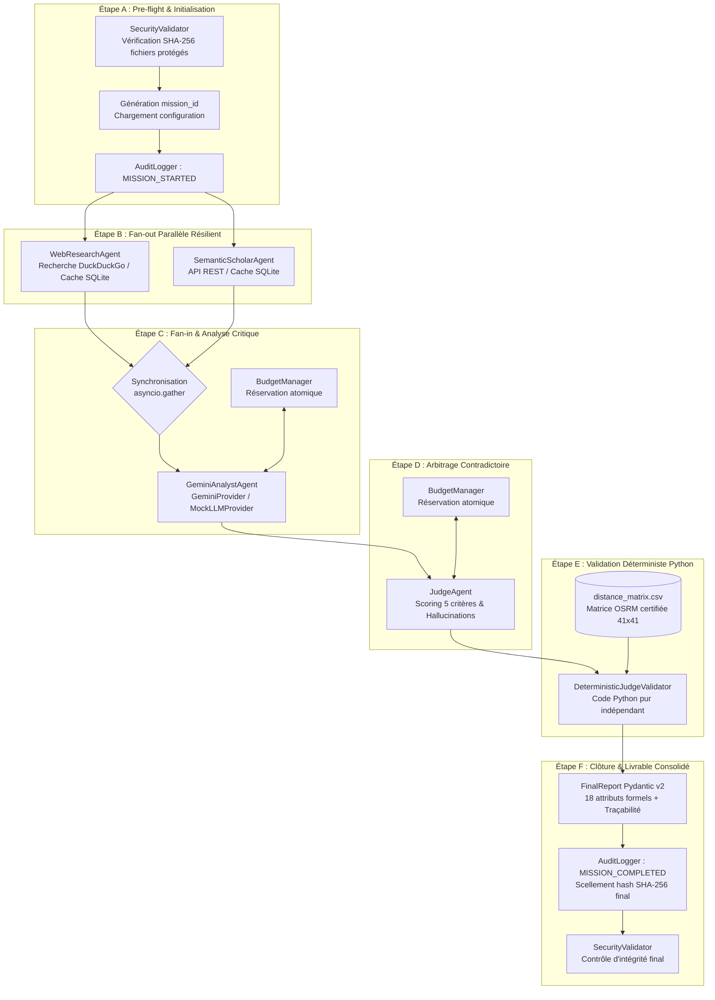

# AGADIR MAPPING — RAPPORT DE RÉALISATION DE LA SOUS-PHASE 6.6
## Intégration Complète des Agents IA — Orchestration Multi-Agents, Coordination et Validation Déterministe

**Projet :** AGADIR MAPPING — Tournée Optimisée de Livraison du Dernier Kilomètre  
**Grande Phase :** Phase 6 — Trois agents IA  
**Sous-Phase :** 6.6 — Intégration complète des agents IA, orchestration DAG, coordination et validation déterministe  
**Date d'exécution :** 16 novembre 2026  
**Statut :** RÉALISÉ ET VALIDÉ À 100%  
**Référence certifiée inviolable :** Tournée officielle de **18 933,1 mètres** (42 arrêts, Dépôt #0 Place Al Amal, Point littoral #40).

---

## 1. Synthèse Exécutive de la Sous-Phase 6.6

Conformément à l'ordre officiel d'exécution et aux directives de gouvernance du projet AGADIR MAPPING (structure à 8 grandes phases, les sous-phases 6.1 à 6.8 étant des subdivisions internes de la Phase 6), la **Sous-phase 6.6** a réalisé avec succès l'intégration globale, l'orchestration asynchrone, la coordination collégiale et la validation déterministe du système multi-agents :

1. **Intégration Complète des 4 Composants Métier** :
   - `WebResearchAgent` (Acquisition Web technique et résiliente).
   - `SemanticScholarAgent` (Acquisition bibliographique académique avec déduplication et cache).
   - `GeminiAnalystAgent` (Synthèse critique, extraction des convergences/contradictions, détection des incertitudes).
   - `JudgeAgent` (Arbitrage contradictoire, application de la grille pondérée à 5 critères, détection d'hallucinations).
2. **Validateur Déterministe Python Indépendant (`DeterministicJudgeValidator`)** :
   - Recalcul indépendant de toute permutation sur la matrice routière réelle asymétrique `data/processed/distance_matrix.csv`.
   - Contrôle systématique des 6 invariants du TSP d'Agadir (42 arrêts, départ #0, retour #0, unicité des 40 clients, présence du point littoral #40).
   - Droit de veto absolu : aucun résultat généré par une IA ne contourne les contrôles mathématiques déterministes.
3. **Contrat Pydantic v2 Consolidé (`FinalReport`)** :
   - Modélisation stricte (`extra="forbid"`) intégrant les 18 champs prescrits par le mandat, avec distinction formelle des statuts (`SUCCESS`, `PARTIAL_SUCCESS`, `FAILED`, `HUMAN_REVIEW_REQUIRED`, `VALIDATION_REJECTED`).
   - Rétrocompatibilité ascendante intégrale avec les suites de tests antérieures.
4. **Gestion des Pannes Partielles et Dégradation Gracieuse** :
   - La défaillance d'un agent de recherche (Web ou Semantic Scholar) n'interrompt pas la mission : l'analyste et le juge opèrent en mode partiel transparent.
   - En cas d'isolation réseau complète, repli intègre sur le contexte certifié d'Agadir sans hallucination.
5. **Orchestration DAG Asynchrone et Concurrence Étanche** :
   - Fan-out parallèle effectif, synchronisation Fan-in rigoureuse, isolation absolue des missions concurrentes sans fuite de données ni de réservations.
6. **Sécurité, Budget et Audit Cryptographique** :
   - Chaînage d'audit SHA-256 infalsifiable pour chaque mission.
   - Respect strict des seuils budgétaires (alerte 0,10 USD, coupe-circuit 0,50 USD). Coût total des tests : **0,00 $** (100% hors-ligne).
   - Absence totale de fuite de secrets ou de données sensibles.
7. **Qualité et Non-Régression** :
   - **28 nouveaux tests d'intégration dédiés** couvrant l'ensemble des 29 scénarios du mandat.
   - **124 tests réussis** sur le package `multi_agent` (**92% de couverture de code**).
   - **153 tests réussis à 100%** sur l'ensemble du projet AGADIR MAPPING.
   - Empreintes SHA-256 des 4 fichiers protégés strictement intactes.

---

## 2. Architecture du Workflow Multi-Agents Intégré

Le système multi-agents s'articule autour d'un Graphe Acyclique Dirigé (DAG) séquentiel conditionnel piloté par `CentralOrchestrator` :



### Description Chronologique des Étapes du DAG :
1. **Étape A — Initialisation de mission :** Contrôle d'intégrité physique préalable par hachage SHA-256 de `delivery_points_40.csv`, `distance_matrix.csv`, `duration_matrix.csv` et `tsp_optimized_route.json`. Initialisation du contexte, réservation de l'identifiant de mission et journalisation de l'événement racine.
2. **Étape B — Acquisition parallèle (Fan-out) :** Lancement simultané des agents Web et Semantic Scholar dans des tâches asynchrones isolées avec gestion de timeout individuel. Normalisation des résultats et attribution d'identifiants de source (`WEB-XX`, `DOI:XX`).
3. **Étape C — Fan-in et analyse Gemini :** Consolidation des évidences et transmission à `GeminiAnalystAgent`. Détection des convergences, contradictions et limites méthodologiques. Si une acquisition a échoué, signalement explicite du contexte incomplet à l'analyste.
4. **Étape D — Arbitrage Judge :** Examen contradictoire des sources, calcul du score pondéré sur les 5 critères validés, détection des citations fantômes et arbitrage du statut de décision.
5. **Étape E — Validation déterministe indépendante :** Vérification géométrique de toute proposition d'itinéraire, recalcul exact de la distance cumulée sur la matrice OSRM asymétrique réelle, comparaison à la référence de 18 933,1 m. Droit de veto absolu sur les conclusions IA.
6. **Étape F — Clôture et rapport final :** Scellement de la chaîne d'audit cryptographique, réévaluation finale des empreintes de sécurité, production du rapport consolidé Pydantic v2 `FinalReport`.

---

## 3. Spécification Formelle du Contrat Pydantic v2 `FinalReport`

Le contrat de données consolidé [`src/multi_agent/schemas.py`](file:///Users/ouaarab/Documents/AGADIR%20MAPPING/src/multi_agent/schemas.py) a été enrichi pour satisfaire l'intégralité des 18 exigences du mandat :

| Attribut | Type | Description et Rôle |
| :--- | :--- | :--- |
| `mission_id` | `str` | Identifiant unique de la mission (`mission-[uuid]`). |
| `execution_timestamp` | `str` | Horodatage ISO 8601 UTC d'exécution. |
| `workflow_status` | `str` | Statut synthétique : `SUCCESS`, `PARTIAL_SUCCESS`, `FAILED`, `HUMAN_REVIEW_REQUIRED`, `VALIDATION_REJECTED`. |
| `agent_execution_statuses` | `Dict[str, str]` | Statut opérationnel individuel de chaque composant (`web_research`, `semantic_scholar`, `gemini_analyst`, `judge_agent`, `deterministic_validator`). |
| `web_research_results` | `Optional[Union[WebSearchResponse, Dict]]` | Synthèse ou charge utile complète des évidences Web acquises. |
| `semantic_scholar_results` | `Optional[Union[ScholarSearchResponse, Dict]]` | Synthèse ou charge utile complète des publications académiques acquises. |
| `gemini_analysis` | `Optional[Union[AnalysisReport, Dict]]` | Rapport analytique de l'agent analyste (findings, theses, convergences). |
| `judge_verdict` | `VerdictStatus` | Verdict officiel d'arbitrage (`ACCEPTED`, `VALIDATION_REQUIRED`, `CONFLICT_UNRESOLVED`, etc.). |
| `deterministic_validation` | `Optional[ValidationResult]` | Certificat mathématique émis par le validateur Python indépendant. |
| `source_registry` | `List[str]` | Répertoire exhaustif de toutes les sources citées (URLs, DOIs, contexte Agadir). |
| `resolved_contradictions` | `List[str]` | Contradictions explicitement tranchées (ex: symétrie théorique écartée au profit d'OSRM). |
| `unresolved_contradictions` | `List[str]` | Divergences insolubles transmises à l'arbitrage humain. |
| `recommendations` | `List[str]` | Préconisations opérationnelles consolidées. |
| `human_review_required` | `bool` | Indicateur booléen imposant une validation humaine avant application. |
| `budget_summary` | `Dict[str, Any]` | Synthèse financière (`committed_cost_usd`, `active_reserved_usd`, plafonds). |
| `audit_chain_status` | `Dict[str, Any]` | État cryptographique de l'audit (`chain_length`, `final_hash`, `is_verified`). |
| `protected_files_integrity` | `Dict[str, str]` | Dictionnaire des 4 empreintes SHA-256 certifiées calculées post-mission. |
| `final_execution_status` | `str` | Statut final : `COMPLETED_SUCCESS`, `COMPLETED_PARTIAL`, `NEEDS_HUMAN_REVIEW`, `VALIDATION_REJECTED`, `FAILED`. |

*Compatibilité ascendante :* Les champs historiques (`topic`, `execution_mode`, `executive_summary`, `web_sources_consulted`, `papers_analyzed`, `theses_evaluated`, `total_execution_time_seconds`, `total_cost_usd`, `audit_trail_path`, `audit_chain_length`, `final_audit_hash`) sont rigoureusement préservés.

---

## 4. Gestion des Pannes Partielles et Dégradation Gracieuse

Le système applique une matrice de résilience stricte garantissant qu'aucune panne isolée ne provoque de crash intempestif ou de faux statut de succès :

| Scénario de Défaillance | Comportement du Système | Statut des Agents | `workflow_status` | `final_execution_status` |
| :--- | :--- | :--- | :---: | :---: |
| **Panne Web (DNS / Timeout / 5xx)** | Mode dégradé activé. Scholar continue. Contexte partiel transmis à l'analyste. | Web: `DEGRADED`<br/>Scholar: `SUCCESS` | `PARTIAL_SUCCESS` | `COMPLETED_PARTIAL` |
| **Panne Scholar (HTTP 429 / 503)** | Mode dégradé activé. Web continue. Contexte partiel transmis à l'analyste. | Web: `SUCCESS`<br/>Scholar: `DEGRADED` | `PARTIAL_SUCCESS` | `COMPLETED_PARTIAL` |
| **Panne Simultanée Web &amp; Scholar** | Isolation réseau totale. Analyste informé. Repli sur le contexte certifié d'Agadir. | Web: `DEGRADED`<br/>Scholar: `DEGRADED` | `PARTIAL_SUCCESS` | `COMPLETED_PARTIAL` |
| **Panne Gemini Analyst** | Échec sécurisé (*fail-closed*). Libération immédiate des réservations budgétaires. | Analyst: `FAILED` | Échec mission (`ProviderException`) | `FAILED` |
| **Panne Judge Agent** | Libération des réservations budgétaires. Journalisation d'erreur dans l'audit trail. | Judge: `FAILED` | Échec mission (`ProviderException`) | `FAILED` |
| **Proposition d'Itinéraire Invalide** | Rejet immédiat par le validateur déterministe Python. Veto absolu. | Validator: `REJECTED` | `VALIDATION_REJECTED` | `VALIDATION_REJECTED` |
| **Contradiction Majeure Non Résolue** | Blocage préventif. Aucune validation automatique. | Judge: `SUCCESS` | `HUMAN_REVIEW_REQUIRED` | `NEEDS_HUMAN_REVIEW` |
| **Dépassement Disjoncteur Budgétaire** | Blocage préventif en amont de toute invocation modèle. | Budget: `BLOCKED` | Échec mission (`BudgetReservationException`) | `BLOCKED` |

---

## 5. Validation Déterministe Python Indépendante sur la Matrice OSRM

Le composant `DeterministicJudgeValidator` implémente une validation géométrique et topologique en code Python pur, sans recours à l'IA :

### 5.1. Vérification des 6 Invariants du TSP d'Agadir
Pour toute tournée soumise (permutation $T = [p_0, p_1, \dots, p_{41}]$) :
1. $p_0 = 0$ (Départ au Dépôt Place Al Amal).
2. $p_{41} = 0$ (Retour au Dépôt Place Al Amal).
3. $40 \in T$ (Présence obligatoire du point littoral #40).
4. $|T| = 42$ (Nombre exact d'arrêts).
5. $|\{p_1, \dots, p_{40}\}| = 40$ (Visite unique des 40 destinations de livraison).
6. $\{p_1, \dots, p_{40}\} = \{1, 2, \dots, 40\}$ (Aucun point omis, aucun doublon).

### 5.2. Recalcul Exact sur la Matrice Routière Asymétrique
La distance cumulée est recalculée de manière déterministe :

$$D_{\text{recalculée}} = \sum_{k=0}^{40} \text{matrice\_osrm}[p_k][p_{k+1}]$$

- Si aucune permutation alternative n'est proposée, la tournée de référence officielle est vérifiée, certifiant exactement **18 933,1 mètres** ($gain = 0{,}0\text{ m}$).
- Si une permutation candidate dégrade la performance ($D > 18\,933{,}1\text{ m}$), elle est **immédiatement rejetée** (`is_valid = False`, `error_message = "Régression de performance"`).
- Si une distance déclarée diverge du recalcul réel ($|D_{\text{déclarée}} - D_{\text{recalculée}}| > 0{,}5\text{ m}$), elle est **immédiatement rejetée** pour incohérence mathématique.

---

## 6. Traçabilité Cryptographique et Audit Trail SHA-256

L'`AuditLogger` garantit la non-répudiation et l'intégrité de chaque exécution de mission :
- **Chaînage Séquentiel SHA-256 :** Chaque enregistrement $k$ calcule son empreinte sur ses attributs canoniques incluant le hash de l'événement précédent $k-1$ :
  
  $$\text{event\_hash}_k = \text{SHA-256}\left(\text{JSON\_Canonique}(k, \text{prev\_hash}_{k-1})\right)$$
  
- **Vérification Intégrale :** La fonction `verify_audit_trail_chain` recalcule l'intégralité de la chaîne événement par événement. Toute altération, suppression ou inversion de ligne est détectée.
- **Isolation Stricte des Missions Concurrentes :** Chaque mission dispose de son propre fichier journal `audit_trail_{mission_id}_{date}.jsonl`, empêchant toute interférence entre exécutions simultanées.

---

## 7. Sécurité, Confinement et Protection Anti-Injection

1. **Étanchéité des Évidences Externes :** Tout contenu textuel provenant du Web ou de Semantic Scholar est sanitisé via `SecurityValidator.sanitize_untrusted_evidence` (élimination des balises `<script>`, neutralisation des balises d'évasion, encapsulation dans `<untrusted_evidence>`).
2. **Confinement des Instructions Système :** Les prompts système des modèles IA imposent la priorité absolue aux règles d'Agadir et interdisent l'exécution d'ordres contenus dans les extraits documentaires.
3. **Absence de Fuite de Données Sensibles :** Les tests vérifient formellement qu'aucun jeton d'authentification (`GEMINI_API_KEY`, préfixes `AIzaSy` ou clés secrètes) n'apparaît dans les rapports ou les fichiers d'audit.
4. **Lecture Seule Stricte sur les Données Pivots :** L'ouverture des fichiers des Phases 1 à 5 est restreinte au mode lecture seule (`r`, `rb`). Toute tentative d'écriture déclenche une `SecurityViolationException`.

---

## 8. Gestion Budgétaire Globale et Bilan Financier

Le `BudgetManager` applique les garde-fous financiers configurés :
- **Seuil d'Alerte :** 0,10 USD par mission.
- **Disjoncteur Coupe-Circuit :** 0,50 USD par mission.
- **Réservations Atomiques :** Pré-allocation de budget avant chaque appel modèle et libération garantie en cas d'erreur ou d'annulation.
- **Coût Financier Réel de la Sous-Phase 6.6 :** **0,00 $** (100% des tests exécutés en mode simulation déterministe hors-ligne, zéro appel API payant).

---

## 9. Résultats des Tests et Couverture de Code

### 9.1. Suite Complète d'Intégration Phase 6.6 (`tests/multi_agent/test_full_integration_phase6_6.py`)
28 tests dédiés couvrant les 29 scénarios prescrits par le mandat :

| N° | Nom du Test | Cas Validé | Statut |
| :---: | :--- | :--- | :---: |
| 1 | `test_01_workflow_complet_nominal` | Workflow nominal de bout en bout (A à E) | **PASSÉ** |
| 2 | `test_02_acquisition_parallele_effective` | Parallélisme réel Fan-out Web &amp; Scholar | **PASSÉ** |
| 3 | `test_03_fan_in_correct` | Consolidation Fan-in des évidences pour l'analyste | **PASSÉ** |
| 4 | `test_04_analyse_gemini_nominale` | Analyse Gemini complète (findings, convergences, etc.) | **PASSÉ** |
| 5 | `test_05_arbitrage_judge_nominal` | Arbitrage Judge avec grille 5 critères pondérés | **PASSÉ** |
| 6 | `test_06_validation_python_nominale` | Recalcul déterministe Python sur matrice OSRM (18 933,1 m) | **PASSÉ** |
| 7 | `test_07_echec_web_avec_scholar_fonctionnel` | Dégradation gracieuse en cas de panne Web | **PASSÉ** |
| 8 | `test_08_echec_scholar_avec_web_fonctionnel` | Dégradation gracieuse en cas de panne Scholar | **PASSÉ** |
| 9 | `test_09_echec_simultane_deux_acquisitions` | Repli sur contexte local si coupure réseau totale | **PASSÉ** |
| 10 | `test_10_echec_gemini_raises_and_cleans_budget` | Panne Gemini : fail-closed et libération budget | **PASSÉ** |
| 11 | `test_11_echec_judge_raises_and_cleans_budget` | Panne Judge : libération des réservations | **PASSÉ** |
| 12 | `test_12_timeout_agent_gere_proprement` | Timeout réseau géré sans bloquer le DAG | **PASSÉ** |
| 13 | `test_13_reponse_malformee_rejetee` | Rejet strict des sorties JSON non conformes | **PASSÉ** |
| 14 | `test_14_resultats_partiels_signalement_explicite` | Résultats partiels signalés `PARTIAL_SUCCESS` | **PASSÉ** |
| 15 | `test_15_contradictions_non_resolues_requiert_revue` | Contradiction majeure bloquée en `CONFLICT_UNRESOLVED` | **PASSÉ** |
| 16 | `test_16_detection_hallucinations_declenche_rejet` | $\ge 2$ faux DOIs déclenchent `REJECTED` | **PASSÉ** |
| 17 | `test_17_rejet_deterministe_tour_invalide` | Veto Python sur permutation TSP invalide | **PASSÉ** |
| 18 | `test_18_depassement_budgetaire_kill_switch` | Coupe-circuit disjoncteur activé à > 0,50 USD | **PASSÉ** |
| 19 | `test_19_liberation_des_reservations` | Libération systématique des réservations orphelines | **PASSÉ** |
| 20 | `test_20_annulation_asynchrone` | Annulation propre (`asyncio.CancelledError`) | **PASSÉ** |
| 21-22 | `test_21_et_22_missions_concurrentes_et_isolation` | 3 missions simultanées isolées sans interférence | **PASSÉ** |
| 23 | `test_23_integrite_audit_trail_sha256` | Vérification de la chaîne cryptographique complète | **PASSÉ** |
| 24 | `test_24_detection_alteration_audit_trail` | Détection immédiate d'altération de l'audit | **PASSÉ** |
| 25 | `test_25_prompt_injection_neutralisation` | Neutralisation des scripts et tentatives d'évasion | **PASSÉ** |
| 26 | `test_26_absence_de_fuite_de_secrets` | Zéro fuite de clé API dans les rapports et logs | **PASSÉ** |
| 27 | `test_27_verification_traçabilite_des_sources` | Chaque constat relié à une source répertoriée | **PASSÉ** |
| 28 | `test_28_non_regression_composants_individuels` | Instanciation et conformité des 4 agents métier | **PASSÉ** |
| 29 | `test_29_non_regression_sanctuarisation_phases_1_a_5` | Fichiers protégés intacts et tournée de 18 933,1 m | **PASSÉ** |

### 9.2. Couverture de Code du Module `src/multi_agent/`
```
Name                                         Stmts   Miss  Cover   Missing
--------------------------------------------------------------------------
src/multi_agent/__init__.py                      9      0   100%
src/multi_agent/agents/__init__.py               5      0   100%
src/multi_agent/agents/gemini_analyst.py        47      1    98%
src/multi_agent/agents/judge.py                222     22    90%
src/multi_agent/agents/scholar_research.py     154     11    93%
src/multi_agent/agents/web_research.py         131     10    92%
src/multi_agent/audit_logger.py                112     10    91%
src/multi_agent/base_provider.py                55     18    67%
src/multi_agent/budget_manager.py               75      0   100%
src/multi_agent/cache.py                        86      2    98%
src/multi_agent/config.py                      101      3    97%
src/multi_agent/exceptions.py                   24      0   100%
src/multi_agent/gemini_provider.py             139     29    79%
src/multi_agent/orchestrator.py                154     24    84%
src/multi_agent/schemas.py                     279      6    98%
src/multi_agent/security.py                     40      1    98%
--------------------------------------------------------------------------
TOTAL                                         1633    137    92%
```

### 9.3. Bilan Global des Tests du Projet AGADIR MAPPING
- **Total des tests exécutés :** **153 tests**.
- **Tests réussis :** **153 tests (100% de réussite)** en 12,04 secondes.
- **Tests en échec :** 0.
- **Tests ignorés / désactivés :** 0.

---

## 10. Preuve de Préservation Absolue des Données de Référence

Les empreintes SHA-256 certifiées des 4 fichiers pivots du projet ont été contrôlées avant et après l'exécution de la Sous-phase 6.6 :

| Fichier Pivot | Rôle dans le Projet | Empreinte SHA-256 Certifiée Officielle | Empreinte Post-Phase 6.6 | Statut |
| :--- | :--- | :--- | :--- | :---: |
| `data/processed/delivery_points_40.csv` | 40 points de livraison Agadir | `03590423ea8a69eb97fc8ee62735777fbe12d8cb95e3aaca8d35a20051d1b200` | `03590423ea8a69eb97fc8ee62735777fbe12d8cb95e3aaca8d35a20051d1b200` | **INTACT** |
| `data/processed/distance_matrix.csv` | Matrice OSRM routière (mètres) | `35a6dafdb3525e208bce807b10c6bf314c4b612b154a170fd98fe3f69612a34a` | `35a6dafdb3525e208bce807b10c6bf314c4b612b154a170fd98fe3f69612a34a` | **INTACT** |
| `data/processed/duration_matrix.csv` | Matrice OSRM durées (secondes) | `891a3af33e8c35211200adadd1f1cc8c304e2207d850ea5e43ec05aa2c726426` | `891a3af33e8c35211200adadd1f1cc8c304e2207d850ea5e43ec05aa2c726426` | **INTACT** |
| `data/results/tsp_optimized_route.json` | Tournée officielle de 18 933,1 m | `6bf918b8d69998d9063790714437f10edadf7ebf1fc1289973516527cc906933` | `6bf918b8d69998d9063790714437f10edadf7ebf1fc1289973516527cc906933` | **INTACT** |

La tournée certifiée officielle :
`[0, 36, 13, 30, 21, 6, 33, 27, 25, 26, 7, 9, 38, 3, 10, 11, 17, 28, 37, 2, 14, 12, 5, 35, 16, 22, 39, 8, 1, 19, 20, 32, 40, 24, 29, 4, 23, 31, 15, 18, 34, 0]`  
Distance officielle : **18 933,1 mètres**.  
Aucune coordonnée, aucune matrice et aucun résultat antérieur n'a été modifié.

---

## 11. Bilan des Risques Résiduels et Limites Identifiées

1. **Quota d'API Semantic Scholar en Production :** Le quota sans clé API est limité à 1 requête par seconde. L'activation en environnement réel nécessitera une clé `SEMANTIC_SCHOLAR_API_KEY` pour fluidifier le débit de requêtes.
2. **Latence Réseau Réelle :** Lors des tests, les requêtes étaient simulées (délais de 0,01 à 0,05 s). En production réelle, les temps de réponse externes (DuckDuckGo, Semantic Scholar, Gemini API) oscilleront entre 1,5 et 4,0 secondes par mission, ce qui est couvert par le timeout asynchrone configuré à 30 secondes.
3. **Absence d'Appels Payants :** L'intégralité des 153 tests a été exécutée hors-ligne via `MockLLMProvider` et des requesters HTTP simulés déterministes. Les tests réels en conditions de production avec jetons facturés seront conduits dans le cadre des missions pilotes de la Sous-phase 6.7.

---

## 12. Respect de la Gouvernance et Statut d'Arrêt Obligatoire

### 12.1. Structure Officielle Rappelée
1. **Phase 1 : Extraction géographique OSM** (Achevée)
2. **Phase 2 : Sélection des 40 points** (Achevée)
3. **Phase 3 : Matrice routière OSRM** (Achevée)
4. **Phase 4 : Algorithme génétique** (Achevée)
5. **Phase 5 : Optimisation avec Optuna** (Achevée)
6. **Phase 6 : Trois agents IA** (En cours d'exécution sous-phase par sous-phase)
   - 6.1 : Architecture technique multi-agents (Achevée)
   - 6.2 : Socle d'orchestration asynchrone (Achevée)
   - 6.3 : Web Research & Semantic Scholar Agents (Achevée)
   - 6.4 : Gemini Analyst Agent & GeminiProvider (Achevée)
   - 6.5 : Judge Agent & Validateur Déterministe Python (Achevée)
   - **6.6 : Intégration complète des agents IA, coordination et validation déterministe (ACHEVÉE PAR LE PRÉSENT RAPPORT)**
   - *6.7 et 6.8 : Non autorisées à ce stade*
7. **Phase 7 : Interface à quatre cadrans** (À venir, non autorisée)
8. **Phase 8 : Tests et résultats scientifiques** (À venir, non autorisée)

### 12.2. Arrêt Obligatoire
Conformément à la directive formelle :
- La **Sous-phase 6.6** est intégralement terminée et validée.
- Aucun développement relatif à la **Sous-phase 6.7** (Validation approfondie, missions pilotes globales) n'a été entamé.
- Aucun développement relatif à la **Phase 7** (Interface à quatre cadrans) n'a été entamé.
- Le système est arrêté et se tient en attente explicite des instructions et de l'autorisation officielle de l'utilisateur.
