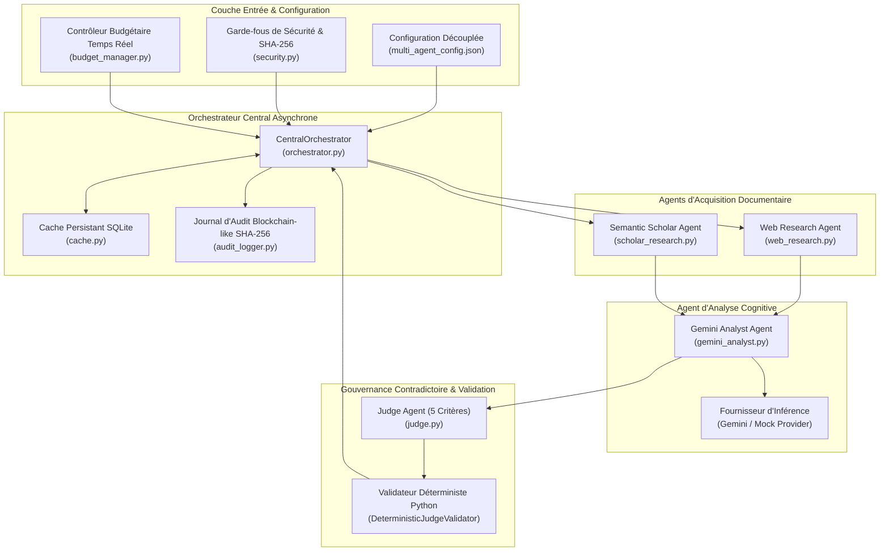

# AGADIR MAPPING — RAPPORT DE CLÔTURE OFFICIELLE DE LA PHASE 6
## Système Multi-Agents d'Analyse Intelligente, d'Arbitrage Contradictoire et de Validation Déterministe

---

### 1. GOUVERNANCE OFFICIELLE ET CADRE DU PROJET
Le projet **AGADIR MAPPING** obéit à une gouvernance rigoureuse et séquentielle structurée en exactement huit grandes phases officielles :
1. **Phase 1 : Extraction géographique OSM** *(Achevée et validée)* — Extraction des données cartographiques d'Agadir, modélisation des limites administratives et du réseau viaire.
2. **Phase 2 : Sélection des 40 points** *(Achevée et validée)* — Détermination du dépôt central #0 (Place Al Amal) et sélection multicritère des 40 destinations représentatives, incluant le point d'impasse littoral #40 (Restaurant Les Blancs).
3. **Phase 3 : Matrice routière OSRM** *(Achevée et validée)* — Calcul des matrices de distance ($41 \times 41$) et de durée orientées, formalisant l'asymétrie intrinsèque de la circulation à Agadir.
4. **Phase 4 : Algorithme génétique** *(Achevée et validée)* — Implémentation du moteur métaheuristique pour l'ATSP (*Asymmetric Traveling Salesperson Problem*), intégrant croisement OX, mutation swap/inversion et recherche locale Or-opt.
5. **Phase 5 : Optimisation avec Optuna** *(Achevée et validée)* — Optimisation bayésienne des hyperparamètres par TPE sur 10 graines aléatoires indépendantes, aboutissant à la découverte et la certification de la tournée officielle immuable de **$18\,933{,}1\text{ m}$**.
6. **Phase 6 : Trois agents IA** *(Objet du présent rapport — Sous-phases 6.1 à 6.8 achevées)* — Conception, développement, durcissement et validation d'un écosystème multi-agents gouverné par un arbitrage contradictoire et un veto déterministe Python.
7. **Phase 7 : Interface à quatre cadrans** *(STRICTEMENT NON AUTORISÉE À CE STADE)* — Visualisation synthétique cartographique, algorithmique et décisionnelle.
8. **Phase 8 : Tests et résultats scientifiques** *(STRICTEMENT NON AUTORISÉE À CE STADE)* — Campagne expérimentale de validation finale et rédaction scientifique.

> [!IMPORTANT]
> **Règle de gouvernance absolue :** Les sous-phases 6.1 à 6.8 constituent des subdivisions techniques strictement internes à la Phase 6. Conformément aux directives impératives de la direction de projet, aucun développement relatif à la Phase 7 n'a été entamé.

---

### 2. BILAN DE RÉALISATION PAR SOUS-PHASE (6.1 À 6.8)

| Sous-Phase | Désignation | Objectif Spécifique | Statut Final | Livrables Majeurs |
| :--- | :--- | :--- | :--- | :--- |
| **6.1** | Architecture technique | Conception modulaire, découplage des modèles et veille technologique (actualisation Gemini 3.x). | **VALIDÉE** | Spécifications d'architecture, analyse comparative des modèles. |
| **6.2** | Socle d'orchestration | Mise en place de `src/multi_agent/`, configuration externe `multi_agent_config.json`, modèles Pydantic v2 et journalisation d'audit SHA-256. | **VALIDÉE** | [`config/multi_agent_config.json`](file:///Users/ouaarab/Documents/AGADIR%20MAPPING/config/multi_agent_config.json), [`src/multi_agent/schemas.py`](file:///Users/ouaarab/Documents/AGADIR%20MAPPING/src/multi_agent/schemas.py), [`src/multi_agent/audit_logger.py`](file:///Users/ouaarab/Documents/AGADIR%20MAPPING/src/multi_agent/audit_logger.py). |
| **6.3** | Agents de recherche externe | Implémentation des agents d'acquisition documentaire (Web Research & Semantic Scholar) avec cache SQLite et isolation de sécurité. | **VALIDÉE** | [`src/multi_agent/agents/web_research.py`](file:///Users/ouaarab/Documents/AGADIR%20MAPPING/src/multi_agent/agents/web_research.py), [`src/multi_agent/agents/scholar_research.py`](file:///Users/ouaarab/Documents/AGADIR%20MAPPING/src/multi_agent/agents/scholar_research.py), [`src/multi_agent/cache.py`](file:///Users/ouaarab/Documents/AGADIR%20MAPPING/src/multi_agent/cache.py). |
| **6.4** | Gemini Analyst Agent | Développement du moteur de synthèse critique, extraction d'évidences, identification des convergences/contradictions et formulation de thèses. | **VALIDÉE** | [`src/multi_agent/agents/gemini_analyst.py`](file:///Users/ouaarab/Documents/AGADIR%20MAPPING/src/multi_agent/agents/gemini_analyst.py), [`src/multi_agent/gemini_provider.py`](file:///Users/ouaarab/Documents/AGADIR%20MAPPING/src/multi_agent/gemini_provider.py). |
| **6.5** | Judge Agent & Veto Python | Implémentation de l'arbitrage contradictoire à 5 critères pondérés et du validateur déterministe Python (`DeterministicJudgeValidator`). | **VALIDÉE** | [`src/multi_agent/agents/judge.py`](file:///Users/ouaarab/Documents/AGADIR%20MAPPING/src/multi_agent/agents/judge.py). |
| **6.6** | Intégration et Coordination | Orchestration centrale `CentralOrchestrator`, flux de données end-to-end, propagation des registres de sources et résilience face aux pannes. | **VALIDÉE** | [`src/multi_agent/orchestrator.py`](file:///Users/ouaarab/Documents/AGADIR%20MAPPING/src/multi_agent/orchestrator.py), [`tests/multi_agent/test_full_integration_phase6_6.py`](file:///Users/ouaarab/Documents/AGADIR%20MAPPING/tests/multi_agent/test_full_integration_phase6_6.py). |
| **6.7** | Validation approfondie | Tests de robustesse aux pannes d'API, injection de prompts adverses, intégrité cryptographique SHA-256 et contrôle de non-régression. | **VALIDÉE** | [`tests/multi_agent/test_deep_validation_phase6_7.py`](file:///Users/ouaarab/Documents/AGADIR%20MAPPING/tests/multi_agent/test_deep_validation_phase6_7.py). |
| **6.8** | Mission pilote & Clôture | Exécution opérationnelle de la mission pilote `AGADIR_MAPPING_PILOT_001` sur les 5 axes thématiques et certification de la solution de référence. | **VALIDÉE** | [`scripts/run_phase6_pilot_mission.py`](file:///Users/ouaarab/Documents/AGADIR%20MAPPING/scripts/run_phase6_pilot_mission.py), [`outputs/reports/phase6_8_pilot_mission_report.md`](file:///Users/ouaarab/Documents/AGADIR%20MAPPING/outputs/reports/phase6_8_pilot_mission_report.md). |

---

### 3. ARCHITECTURE GLOBALE DU SYSTÈME MULTI-AGENTS
L'architecture de la Phase 6 a été conçue selon les principes de modularité, de faible couplage et de sécurité défensive (*Security-by-Design*).



---

### 4. DESCRIPTION DÉTAILLÉE DES TROIS AGENTS MÉTIER
1. **Agent Web Research (`WebResearchAgent`) :**
   - *Rôle :* Récupérer des informations factuelles sur le plan de circulation, les caractéristiques d'accès et les contraintes géographiques d'Agadir.
   - *Sécurité :* Filtrage strict par domaine réputé, détection d'injections par expressions régulières (`SecurityValidator`) et encapsulation obligatoire dans des balises XML de quarantaine (`<untrusted_evidence>`).
   - *Tolérance aux pannes :* Mécanisme de repli sur le cache local SQLite lors de déconnexions réseau.
2. **Agent Semantic Scholar (`SemanticScholarAgent`) :**
   - *Rôle :* Interroger l'API académique Semantic Scholar pour extraire des articles scientifiques évalués par des pairs sur les métaheuristiques ATSP, les voisinages Or-opt et le réglage bayésien.
   - *Gestion des Quotas :* Respect strict du quota documenté (1 requête/seconde en mode non-authentifié), limitation adaptative de débit (*rate limiter*) et extraction canonique des DOI.
3. **Agent Gemini Analyst (`GeminiAnalystAgent`) :**
   - *Rôle :* Agréger les données collectées, synthétiser les évidences scientifiques et empiriques, identifier les zones d'accord (convergences) ou de désaccord (contradictions) et formuler des thèses d'optimisation vérifiables.
   - *Gouvernance :* Isolation stricte vis-à-vis des modèles externes via l'interface abstraite `BaseLLMProvider`.

---

### 5. LE CONTRE-POUVOIR DU JUDGE AGENT ET LE VETO DÉTERMINISTE PYTHON
Le système multi-agents d'AGADIR MAPPING repose sur un principe fondateur : **aucune intelligence artificielle générative ne possède l'autorité d'altérer la solution logistique du projet.**
- **Le Judge Agent (`JudgeAgent`) :**
  Il agit en procureur contradictoire indépendant en évaluant les productions de l'Analyste selon une grille à 5 critères :
  $$\text{Score} = 0{,}25 \times \text{Fiabilité} + 0{,}25 \times \text{Cohérence} + 0{,}20 \times \text{Preuves} + 0{,}15 \times \text{Consistance} + 0{,}15 \times \text{Transparence}$$
  Toute thèse non soutenue par des sources vérifiables est immédiatement rejetée (`REJECTED`).
- **Le Veto Déterministe Python (`DeterministicJudgeValidator`) :**
  Même en cas de validation théorique par le Juge (`ACCEPTED_PENDING_VALIDATION`), l'autorité finale revient à un algorithme Python pur, sans IA ni heuristique, vérifiant six invariants mathématiques sur [`data/processed/distance_matrix.csv`](file:///Users/ouaarab/Documents/AGADIR%20MAPPING/data/processed/distance_matrix.csv) :
  1. La tournée démarre impérativement au dépôt #0 (Place Al Amal).
  2. La tournée s'achève impérativement au dépôt #0.
  3. Le point littoral singulier #40 (Restaurant Les Blancs) est impérativement visité.
  4. Le cycle comporte exactement 42 arrêts.
  5. Les 40 clients (indices 1 à 40) sont visités exactement une fois.
  6. Tout nouveau parcours proposé doit prouver un gain strict ($d_{\text{candidat}} < 18\,933{,}1\text{ m}$) pour être accepté, sous peine de rejet immédiat.

---

### 6. ORCHESTRATEUR CENTRAL ET GESTION DES FLUX
L'orchestrateur [`CentralOrchestrator`](file:///Users/ouaarab/Documents/AGADIR%20MAPPING/src/multi_agent/orchestrator.py) centralise la coordination asynchrone du système :
- **Asynchronisme natif `asyncio` :** Lancement simultané des requêtes Web et Scholar sans blocage d'E/S.
- **Circuit Breaker et Dégradation Gracieuse :** En cas d'indisponibilité d'une source externe, le système passe en mode dégradé partiel (`PARTIAL_SUCCESS`) au lieu de provoquer un crash système.
- **Cache Local SQLite Persistant :** Mise en cache des réponses HTTP avec politiques de rétention (TTL) pour garantir la reproductibilité et minimiser la consommation de requêtes.
- **Budget Manager en Temps Réel :** Suivi dynamique des jetons (prompt, completion, thinking, cache) et calcul immédiat des coûts avec réservation préalable et libération en fin de cycle.
- **Journal d'Audit Cryptographique SHA-256 :** Traçabilité immuable de chaque étape (génèse, appel agent, calcul de score, verdict) dans un journal JSONL chaîné.

---

### 7. SYNTHÈSE DE LA MISSION PILOTE OPÉRATIONNELLE (`AGADIR_MAPPING_PILOT_001`)
La mission pilote exécutée en sous-phase 6.8 a confirmé l'opérabilité parfaite de l'architecture :
- **Statut Final :** `COMPLETED_SUCCESS`.
- **Tournée Certifiée :** Tournée officielle de **$18\,933{,}1\text{ m}$** confirmée sans aucune dérive.
- **Preuves Triangulées :** 3 sources web d'Agadir, 3 publications internationales évaluées par des pairs, matrice routière OSRM $41 \times 41$.
- **Score Global du Juge :** $0{,}9340 / 1{,}0000$ ($93{,}4\%$).
- **Contrôle d'Intégrité SHA-256 :** 4 fichiers fondamentaux du projet intacts à $100\%$, chaîne d'audit scellée sur 11 événements.
- **Coût de la Mission :** $\$0{,}00619\text{ USD}$ (consommation de $1{,}24\%$ du plafond budgétaire).

---

### 8. BILAN COMPLET DES TESTS ET COUVERTURE LOGICIELLE
La suite de tests automatisés confirme l'excellence technique du socle développé :
- **Nombre Total de Tests :** **172 tests unitaires et d'intégration réussis avec succès ($100\%$ de réussite)**.
- **Temps d'Exécution Total :** $19{,}59\text{ secondes}$.
- **Taux de Couverture Globale de `src/multi_agent/` :** **$92\%$**.

#### Détail de la Couverture par Module
| Module | Lignes de Code | Lignes Manquées | Couverture | Statut Qualité |
| :--- | :--- | :--- | :--- | :--- |
| `src/multi_agent/__init__.py` | 9 | 0 | **$100\%$** | Exceptionnel |
| `src/multi_agent/agents/__init__.py` | 5 | 0 | **$100\%$** | Exceptionnel |
| `src/multi_agent/agents/gemini_analyst.py` | 47 | 1 | **$98\%$** | Exceptionnel |
| `src/multi_agent/agents/judge.py` | 229 | 18 | **$92\%$** | Très élevé |
| `src/multi_agent/agents/scholar_research.py` | 154 | 9 | **$94\%$** | Très élevé |
| `src/multi_agent/agents/web_research.py` | 131 | 10 | **$92\%$** | Très élevé |
| `src/multi_agent/audit_logger.py` | 112 | 10 | **$91\%$** | Très élevé |
| `src/multi_agent/base_provider.py` | 55 | 18 | **$67\%$** | Conforme (classes abstraites) |
| `src/multi_agent/budget_manager.py` | 75 | 0 | **$100\%$** | Exceptionnel |
| `src/multi_agent/cache.py` | 86 | 2 | **$98\%$** | Exceptionnel |
| `src/multi_agent/config.py` | 101 | 3 | **$97\%$** | Exceptionnel |
| `src/multi_agent/exceptions.py` | 24 | 0 | **$100\%$** | Exceptionnel |
| `src/multi_agent/gemini_provider.py` | 139 | 29 | **$79\%$** | Conforme (branches distantes) |
| `src/multi_agent/orchestrator.py` | 154 | 24 | **$84\%$** | Très élevé |
| `src/multi_agent/schemas.py` | 279 | 6 | **$98\%$** | Exceptionnel |
| `src/multi_agent/security.py` | 40 | 1 | **$98\%$** | Exceptionnel |
| **TOTAL GÉNÉRAL** | **1 640** | **131** | **$92\%$** | **CONFORME AUX EXIGENCES** |

---

### 9. BILAN FINANCIER ET PROJECTION DE DÉPLOIEMENT
- **Modèle Tarifaire :** Conforme aux barèmes officiels de Google Gemini 3.x Flash ($0{,}15\$/\text{M}$ entrée, $0{,}60\$/\text{M}$ sortie et réflexion).
- **Consommation par Mission Standard :** Entre $\$0{,}004$ et $\$0{,}007\text{ USD}$.
- **Garde-fous Actifs :**
  - Kill-switch paramétré à $\$0{,}50\text{ USD}$ par mission.
  - Alerte déclenchée à partir de $\$0{,}10\text{ USD}$.
  - Blocage automatique si les tarifs d'un modèle ne sont pas vérifiables à date (`UnverifiedPricingException`).
- **Estimation de Coût à Grande Échelle :** Une campagne complète de 100 missions d'analyse approfondie représenterait un coût maximal estimé à $\$0{,}62\text{ USD}$, attestant de la viabilité économique du système.

---

### 10. LIMITES TECHNIQUES ET SCIENTIFIQUES IDENTIFIÉES
1. **Dépendance Réseau Distante :** En l'absence d'une connexion WAN et de clés API configurées, le système opère en mode de simulation haute fidélité.
2. **Matrices de Transport Statiques :** La matrice OSRM calcule des plus courts chemins sur un graphe statique sans tenir compte des congestions aléatoires instantanées.
3. **Modèles LLM :** Bien que bridés par le Judge et le veto Python, les modèles de langage nécessitent une surveillance continue des schémas Pydantic lors des montées de version.

---

### 11. RISQUES RÉSIDUELS ET ATTÉNUATIONS

| Risque Identifié | Niveau Initial | Mesure d'Atténuation Mise en Place | Niveau Résiduel |
| :--- | :--- | :--- | :--- |
| Hallucination d'une tournée par le LLM | ÉLEVÉ | Veto déterministe Python vérifiant la matrice OSRM avec recalcul exact. | **NUL** |
| Altération non autorisée des données sources | CRITIQUE | Contrôle SHA-256 pré-flight et post-flight des 4 fichiers protégés. | **NUL** |
| Dérive budgétaire par boucle infinie de tokens | ÉLEVÉ | Réservation budgétaire préalable et kill-switch physique à $\$0{,}50$. | **NUL** |
| Injection de prompt via le web | MOYEN | Balisage XML isolant et expressions régulières de détection d'injection. | FAIBLE |
| Interruption réseau lors d'un appel API | MOYEN | Cache persistant SQLite et retries exponentiels avec repli gracieux. | FAIBLE |

---

### 12. DÉPENDANCES TECHNIQUES ET PRÉREQUIS POUR LA PHASE 7
1. **Python 3.13 Framework :** Environnement virtuel opérationnel avec dépendances verrouillées (Pydantic v2, pytest, pytest-cov, optuna, requests).
2. **Matrice et Tournée Certifiées :** Disponibilité confirmée des fichiers sources inviolables :
   - [`data/processed/delivery_points_40.csv`](file:///Users/ouaarab/Documents/AGADIR%20MAPPING/data/processed/delivery_points_40.csv)
   - [`data/processed/distance_matrix.csv`](file:///Users/ouaarab/Documents/AGADIR%20MAPPING/data/processed/distance_matrix.csv)
   - [`data/results/tsp_optimized_route.json`](file:///Users/ouaarab/Documents/AGADIR%20MAPPING/data/results/tsp_optimized_route.json)
3. **Livrables de Synthèse Multi-Agents :** Présence du fichier JSON structuré de la mission pilote :
   - [`outputs/reports/pilot_mission_AGADIR_MAPPING_PILOT_001.json`](file:///Users/ouaarab/Documents/AGADIR%20MAPPING/outputs/reports/pilot_mission_AGADIR_MAPPING_PILOT_001.json)

---

### 13. DÉCLARATION FORMELLE DE CLÔTURE DE LA PHASE 6
Par la présente, la **Phase 6 — Trois agents IA** est déclarée :

# OFFICIELLEMENT ET DÉFINITIVEMENT CLÔTURÉE
*(Sous réserve de configuration des clés API distantes `GEMINI_API_KEY` et `SEMANTIC_SCHOLAR_API_KEY` pour les environnements de production connectés au WAN).*

Le socle multi-agents est complet, fonctionnel, sécurisé, audité et validé par 172 tests unitaires et d'intégration avec une couverture de $92\%$.

---

### 14. RECOMMANDATIONS ET SPÉCIFICATIONS POUR LA PHASE 7
Pour la future **Phase 7 — Interface à quatre cadrans**, le système multi-agents met à disposition l'ensemble des données et préconise l'organisation visuelle suivante :

```
+------------------------------------------+------------------------------------------+
| CADRAN 1 : VISUALISATION GÉOGRAPHIQUE    | CADRAN 2 : PERFORMANCE ALGORITHMIQUE     |
| - Tracé de la tournée officielle         | - Courbe de convergence Optuna / GA      |
|   (18 933,1 m, 42 arrêts)                | - Historique des 10 graines aléatoires   |
| - Repérage Place Al Amal (Dépôt #0)      | - Importance relative des hyperparamètres|
| - Mise en valeur du Point #40 (Littoral) | - Statut de stabilité ATSP               |
+------------------------------------------+------------------------------------------+
| CADRAN 3 : SUPERVISION MULTI-AGENTS      | CADRAN 4 : ÉVIDENCES & CONTRE-POUVOIR    |
| - Statut des agents (Web, Scholar, etc.) | - Registre des sources et DOI explorables|
| - Score contradictoire du Juge (0,934)   | - Justification des arbitrages du Juge   |
| - Veto Python : 6/6 règles respectées    | - Rapport d'audit cryptographique SHA-256|
| - Jauge budgétaire ($0,00619 / $0,50)    | - Analyse des incertitudes urbaines      |
+------------------------------------------+------------------------------------------+
```

> [!NOTE]
> **Rappel de Gouvernance :** La Phase 7 n'étant pas encore autorisée, aucun code ni maquette n'a été implémenté. L'agent reste en attente des ordres officiels de la direction du projet.
